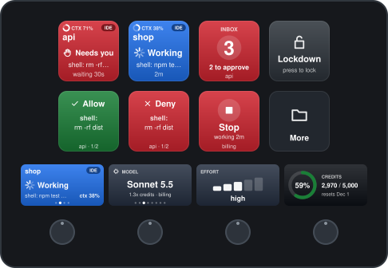
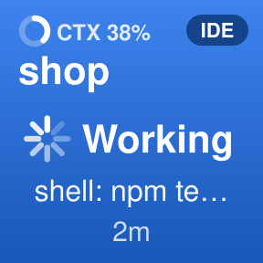
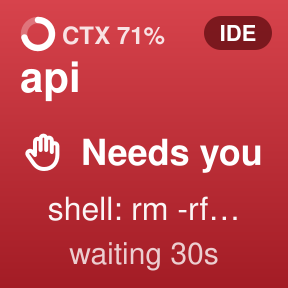
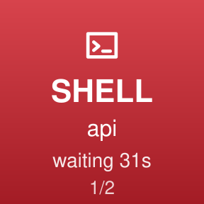
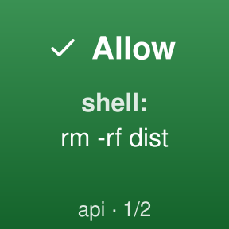
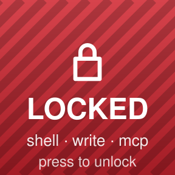
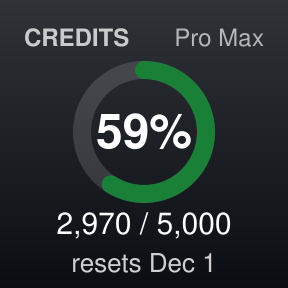
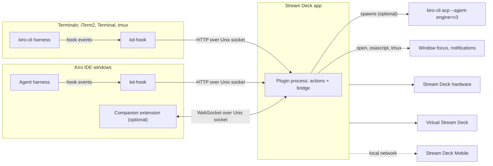
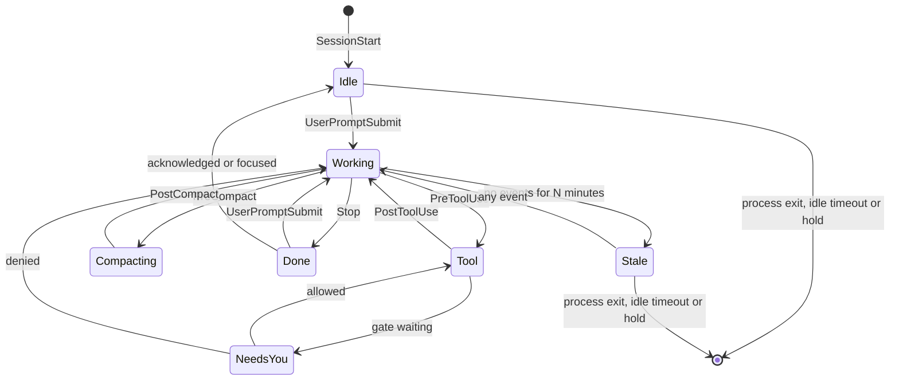
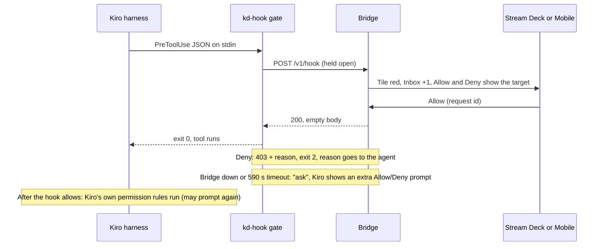

# ki-deck

Track and steer every Kiro session on your Mac from an Elgato Stream Deck, the Stream Deck Mobile app, or Virtual Stream Deck.

<p align="center">
  <a href="docs/HANDBOOK.md"></a>
</p>

|  |  |  |  |  |  |
|:---:|:---:|:---:|:---:|:---:|:---:|
| See what runs | See who needs you | Read the call | Answer it | Panic button | Watch the credits |

<p align="center">
  <a href="docs/HANDBOOK.md"><b>Read the handbook</b></a>: every device layout and every key, with pictures.
  The PDF comes with each <a href="https://github.com/sstreiner/ki-deck/releases/latest">release</a>.
</p>

The name: *ki* for Kiro, and for *künstliche Intelligenz* (German for AI); *deck* for the Stream Deck. By sstreiner.

ki-deck is an independent project, not affiliated with or endorsed by Amazon or Elgato. Kiro is a trademark of Amazon.com, Inc. or its affiliates; Stream Deck and Elgato are trademarks of Corsair Memory, Inc.

**A word about the *ki*.** It stands for Kiro, and also for the AI that wrote most of this. A human brought the idea, the Stream Decks and the stubbornness; Kiro wrote the code, the tests, the handbook and, yes, this paragraph. About halfway through, the plugin started approving the shell commands of the agent that was building it, so the deck has had a hand in its own construction. We'd argue that's not slop: every change had to pass the tests, the README says what was tested live and what wasn't, and nothing shipped on vibes alone. If you find slop anyway, open an issue. A human will read it, probably with some help.

## Prerequisites

| Requirement | Version | Needed for |
|---|---|---|
| macOS | 13 or later | Everything |
| [Stream Deck app](https://www.elgato.com/downloads) | 7.6 or later | Running the plugin (7.6 brought the Neo infobar, which the plugin uses) |
| A Stream Deck device, or the Stream Deck Mobile app | Mobile 2.0 or later, on iOS 15+ or Android 9+ | The keys. Virtual Stream Deck also works, but needs a physical device to unlock |
| Kiro IDE, kiro-cli, or both | IDE 1.4 or later, CLI 3.x on the V3 engine | The sessions being tracked. `kiro-cli` 3.0 chats on its V2 engine by default, which ignores global hooks: run `kiro-cli settings chat.agentEngine v3` once (`doctor` checks this) |
| `curl` and `shasum` | Ship with macOS | Hook client and the `ki-deck` command |
| Node.js and npm | Node 24 or later | `scripts/install.sh` from the repository: it runs the installer and builds the plugin (`--skip-plugin` builds nothing, but still runs on Node). Not needed for the packaged `.streamDeckPlugin`; Stream Deck runs the plugin and its setup on its own bundled Node 24 |
| Kiro's `kiro` command | Optional: Kiro, Command Palette, "Shell Command: Install 'kiro' command in PATH" | Installing the companion extension (Kiro's own prompts, context use, chat focus). Without the command, the installer uses the same launcher inside `Kiro.app` |
| `terminal-notifier` | Optional: `brew install terminal-notifier` | Notifications that focus the right window when clicked |
| The ntfy or Pushover app on the phone | Optional | Push notifications when you are away from the Mac (5.2) |
| Google Chrome (or Chromium, Edge, Brave) | Optional | `npm run handbook:pdf` |

`scripts/install.sh` checks these and tells you what is missing. `ki-deck doctor` re-checks the installation at any time.

## Install

> The plugin has fourteen actions: Session, Inbox, Allow, Deny, Decide in Kiro, Lockdown, Gate, Request and Usage (milestones M1 to M3), and Model, Effort, Autonomy, Stop and Prompt (M4 onward). Model, Effort and Autonomy work for selected Kiro IDE and deck sessions; Stop and Prompt remain deck-session controls. The installer builds it, links it into Stream Deck and starts it. If Stream Deck's developer mode is off, it restarts Stream Deck once to load a new build.

1. From the repository root, preview the changes, then install:

   ```sh
   scripts/install.sh --dry-run   # optional: shows every change, makes none
   scripts/install.sh             # shows the plan, asks once, installs, runs doctor
   ```

2. Kiro loads hooks when a session starts. Open a new chat session in Kiro (and restart any `kiro-cli chat`), send one prompt, then check:

   ```sh
   ki-deck doctor
   ```

   It should report `Kiro IDE called the hooks 12s ago`. The installer links `ki-deck` into the first writable folder on your `PATH` among `~/.local/bin`, `~/bin`, `/opt/homebrew/bin` and `/usr/local/bin`. If there is none, it prints the line to add to `~/.zshrc`: `export PATH="$HOME/.ki-deck/bin:$PATH"`.

3. Put the keys on your devices. For Stream Deck Mobile, pair the phone first from the Stream Deck app's device menu with "Add Mobile Device". Then either:

   ```sh
   ki-deck profiles   # switches every connected device to its Kiro profile
   ```

   Stream Deck asks once per device whether to install the profile; after you confirm, the device switches to it. Or drag keys from the "ki-deck" category in the Stream Deck app yourself; Session keys fill in key order (left to right, top to bottom), so no setup is needed. Don't double-click the `.streamDeckProfile` files: Stream Deck imports them onto whichever device is selected in its window, not the device they were made for.

4. To approve tool calls on the deck, gate a category: `ki-deck gate shell on`. See [Approvals](#54-approvals-allow-and-deny) first.

| Installer option | Effect |
|---|---|
| `--yes`, `-y` | Accept the plan without asking. Required when not run from a terminal |
| `--dry-run`, `-n` | Print what would change, change nothing |
| `--gate shell,write,mcp` | Route approvals for these categories through Stream Deck from the start (default: none) |
| `--skip-plugin` | Only install the Kiro side |
| `--dev` | Also enable Stream Deck developer mode (debugger, inspector at `localhost:23654`) |

Nothing is gated after a fresh install, so Kiro prompts exactly as before. What the installer changes, gates, lockdown, Stream Deck setup and uninstalling are covered in [Install and configure](#10-install-and-configure).

**Without the repository (another Mac):** `make release` builds `dist/ki-deck-<version>.pkg` (which also installs the app "Uninstall ki-deck"), `dist/net.streiner.ki-deck.streamDeckPlugin`, `dist/HANDBOOK.pdf` and `dist/SHA256SUMS` (`make help` lists every target). The `.pkg` is the native way in: double-click it, click Install (no administrator password), and the plugin sets up the Kiro side by itself; signing and notarizing it is in [10.8](#108-macos-installer-package). Or double-click the `.streamDeckPlugin` on the other Mac: Stream Deck installs the plugin, and the plugin then asks once whether to set up the Kiro side, listing what it installs (kd-hook and the `ki-deck` command in `~/.ki-deck`, the global Kiro hooks, the companion extension). "Set up" runs the same installer as above (`--yes`), from inside the package, and a notification says when it is done. "Not now" is remembered for that package; the Inbox key then shows "Set up" until you press it (only while nothing is installed: once the hooks report, the Inbox stays the Inbox). The installer stamps `~/.ki-deck/VERSION`; a later package offers "Update" in the same dialog only when it is newer than that stamp, so it never replaces a newer install from the repository or a hook file you edited. Neither dialog has a default button, so a stray Return cannot start the installer. Node.js is not needed: the setup runs on Stream Deck's own Node. The companion is installed with Kiro's `kiro` command, or with the launcher inside `Kiro.app` when the command is missing. On a Mac that runs the plugin linked from the repository, keep using `scripts/install.sh`: the package would replace the link. Details in [10.7](#107-packaged-release-with-one-click-setup).

**Using it:** the [handbook](docs/HANDBOOK.md) shows every device layout and every key with pictures, and explains what each press does. This README is the design document.

---

> Status: M1 to M5 built, plus live IDE session settings (0.10.0). Built and running: the installer, the hook client, the `ki-deck` CLI, and the plugin with its bridge, live Session and Inbox keys, window focus, notifications and the event ledger (M1), plus approvals on the deck, Lockdown, gate switches, the UNGATED alert, the request banner, the audit trail and bundled profiles (M2), the Usage key with Kiro credits and today's activity, the companion extension that lets the deck answer Kiro's own IDE approval prompts (M3), deck sessions with model, effort, autonomy, stop, steering and approvals (M4), the M5 design and release tooling, and Model, Effort and Autonomy controls for the selected live IDE chat through companion 0.5.0. Sections marked **Built** describe the code as it is; everything else is design. See [Roadmap](#12-roadmap) for what comes next.
> Checked against Kiro IDE 1.4.154, Kiro CLI 3.0.0, Stream Deck 7.6.1 on macOS 26.6, and the Kiro and Elgato docs as of November 2026.
> Items marked **Spike** depend on undocumented behavior and must be verified before anything is built on them (see [Open questions](#13-open-questions-spikes)).

## Contents

Start here: [Prerequisites](#prerequisites), [Install](#install)

1. [Goals](#1-goals)
2. [What Kiro exposes](#2-what-kiro-exposes)
3. [Architecture](#3-architecture)
4. [Session model](#4-session-model)
5. [Features](#5-features)
6. [Feasibility matrix](#6-feasibility-matrix)
7. [Kiro-side configuration](#7-kiro-side-configuration)
8. [Stream Deck plugin](#8-stream-deck-plugin)
9. [Security and privacy](#9-security-and-privacy)
10. [Install and configure](#10-install-and-configure)
11. [Repository layout](#11-repository-layout)
12. [Roadmap](#12-roadmap)
13. [Open questions (spikes)](#13-open-questions-spikes)
14. [References](#14-references)

---

## 1. Goals

Requested:

- Show what every agent is doing, across all Kiro IDE windows and Kiro CLI terminals.
- Track Kiro usage.
- Control the model used per session.
- Steer sessions: allow or deny actions, get notified when something is waiting, jump to the window that needs attention.
- Work on Stream Deck hardware and on the Stream Deck Mobile app.

Added by this design (details in [5.8](#58-additions-beyond-the-original-list)): a lockdown key, waiting-on-you timers, stuck detection, context and compaction signals, spec task progress, a credit budget guard, MCP health, launchers, a presentation mode that hides sensitive text, an approval audit trail, and accessible key design.

Not in scope for v1: Kiro Web and cloud sessions (see open question 12), Windows, approving over the internet.

## 2. What Kiro exposes

| Integration point | What it gives us | Applies to | Status |
|---|---|---|---|
| Hooks: `~/.kiro/hooks/*.json` (global) and `.kiro/hooks/*.json` (workspace) | Event JSON on stdin with `hook_event_name`, `session_id`, `cwd`, `tool_name`, `tool_input`. `PreToolUse` runs before Kiro's own permission check and can block a tool (exit 2, stderr goes to the agent) or ask for an extra Allow/Deny prompt (`permissionDecision: "ask"`). A `Stop` hook can make the agent continue with a reason. Timeout per hook, default 60 s, `0` disables it. Hooks do not run in untrusted workspaces or in IDE windows with no folder open | IDE and CLI | Documented; details confirmed in the harness code (section 13) |
| Agent Client Protocol: `kiro-cli acp --agent-engine=v3` | Full control of sessions we start: model and effort via `session/set_config_option`, `session/request_permission`, `session/cancel`, `_session/steer`, context and turn metering in `session_info_update`, account usage via `_kiro/account/getUsage` | Only sessions our process owns | Documented. Optional methods must be read from the capability advertisement |
| Kiro IDE commands, called from a companion VS Code extension | `kiroAgent.sessions.switch(sessionId)` and `kiroAgent.viewSession(sessionId)` to show a chat session, `kiroAgent.sessions.sendPrompt(sessionId, text)`, `kiroAgent.sessions.close(sessionId)`, `kiroAgent.newSession`, `kiroAgent.focusChatInput`, and `kiroAgent.execution.runOrAcceptAll` / `rejectAll` / `trust` for the window's last active chat. No command stops a turn, changes the model or toggles autonomy | IDE windows | Undocumented; found in `kiro.kiro-agent` 1.1.787 (section 13). Not tested from another extension yet |
| Kiro IDE session metadata (read-only file) | Current `modelId`, `effortLevel`, `autopilot` and `agentMode` in `~/.kiro/sessions/<workspace-hash>/<session-id>/session.json` | IDE sessions known from hooks/the hub | Undocumented, read defensively and never written; verified live in Kiro 1.4.154 |
| Kiro IDE agent hub, through the companion extension | Session roster and context; exact permission responses; `session/set_config_option` for a session ID, returning `configOptions` and `config_option_update` | IDE windows | Undocumented; model, effort and autonomy read/change verified live in Kiro 1.4.154 |
| Permissions: `permissions.yaml` | Policy with `deny > ask > allow > evaluate`, user and workspace scopes | IDE and CLI | Documented. We read and advise; the plugin never writes these files |
| macOS: `open`, AppleScript, Accessibility, terminal CLIs | Focus the right window, tab or pane; notifications | Everything local | Standard macOS |
| Usage | IDE status bar and account settings, CLI `/usage`, ACP `_kiro/account/getUsage`, Kiro console for enterprise | Account | Documented |

The main constraint: Kiro IDE and the Kiro CLI TUI are each ACP clients of their own local agent harness, connected over stdio. An outside process cannot attach to those connections. The companion runs inside Kiro, however, and can use the IDE window's authenticated agent hub. That now gives selected IDE chats exact model, effort and autonomy reads/changes; hooks still provide observation and gates, while stop, prompt and mid-turn steering remain exclusive to deck-owned sessions. CLI TUI sessions remain observational.

## 3. Architecture



Components:

1. `kd-hook`: a small POSIX `sh` + `curl` script that every Kiro hook calls. Observer calls return at once and print nothing. Gate calls wait for your decision.
2. Bridge: a TypeScript module inside the Stream Deck plugin's Node.js process, with no Stream Deck dependency of its own (`src/bridge/`). **Built:** session registry, attention (Inbox), approval queue, event ledger, focus, notifier with optional push, config with live reload, usage monitor, activity report, ACP host for deck sessions, one-click setup for the packaged plugin. It serves HTTP on `~/.ki-deck/run/bridge.sock` (mode `0600`): `POST /v1/hook` for kd-hook; `POST /v1/companion/ask` (native prompts), `POST /v1/companion/context` (context use) and `POST /v1/companion/connect` (a held-open command stream per Kiro window, one JSON line per command) for the companion; `GET /v1/deck` and `POST /v1/deck/<command>` for `ki-deck deck`; `POST /v1/report` and `POST /v1/push/test` for `ki-deck report` and `push test`; and `GET /v1/health` and `GET /v1/sessions` for `doctor` and debugging.
3. Stream Deck actions: keys, dials and the Neo infobar. One plugin serves hardware, Mobile and Virtual Stream Deck, because all of them run plugins on the Mac.
4. Kiro companion extension (optional, `extension/`): every IDE window runs its own extension host. **Built:** it connects to the window's agent hub as an observer, hands Kiro's own approval prompts to the bridge so the deck answers them, reports how full each chat's context window is, and shows the chat (or the integrated terminal) of a pressed Session key (7.4). Planned: allow-listed steering commands.
5. ACP host (optional): starts and owns deck sessions, headless Kiro sessions the deck controls completely (5.9). **Built** (M4): `src/bridge/deck.ts` runs one `kiro-cli acp --agent-engine=v3` for all deck sessions over the ACP client in `src/bridge/acp.ts`, which the Usage key also uses (5.7).

### Design decisions

| Decision | Choice | Why | Revisit when |
|---|---|---|---|
| Primary integration | Hooks | Same mechanism in IDE and CLI, documented, sturdier than UI automation | Kiro ships an API for attaching to running sessions |
| Where the bridge runs | Inside the plugin process | One process, lifecycle owned by Stream Deck, Node.js already there. If Stream Deck is closed, gates fall back to Kiro's own prompts | You want tracking while Stream Deck is closed, or a second UI (menu bar app): move it to a `launchd` agent |
| Transport | Unix domain socket, `0600` | No TCP port and no token to leak; file permissions are the authentication | Never, for a single-user local tool |
| Hook client | `sh` + `curl` | Runs on every tool call, so it must start fast and have no dependencies | n/a |
| Failure behavior | Fall back to Kiro's native prompt, never to allow | A deck outage must not widen permissions | n/a |
| Event storage | Append-only JSONL plus daily rollups | Small volume, easy to inspect, no native modules in the plugin | Reports get slow: switch to SQLite |

## 4. Session model

### Identity

- `session_id` from the hook payload is the key.
- `cwd` gives the workspace; its basename is the display name.
- `kd-hook` adds environment details as headers so the bridge knows where the session lives:

| Signal | Meaning |
|---|---|
| `__CFBundleIdentifier=dev.kiro.desktop` and no controlling tty | Kiro IDE agent |
| `TERM_PROGRAM=iTerm.app` and `ITERM_SESSION_ID` | `kiro-cli` in an iTerm2 session |
| `TERM_PROGRAM=Apple_Terminal` and the parent's tty | `kiro-cli` in a Terminal.app tab |
| `TMUX_PANE` | `kiro-cli` inside tmux |
| `__CFBundleIdentifier=dev.kiro.desktop`, `TERM_PROGRAM=kiro` and a tty | `kiro-cli` in Kiro's integrated terminal (observed) |
| PID of the agent harness (`X-KD-Pid`) | Lets the bridge drop the session when that process exits. In the IDE it is the window's agent process (a "Kiro Helper (Plugin)" node service beside the extension host, one per window, shared by all chats of that window), so it exits only when the window closes or reloads |

`kd-hook` tells IDE from CLI by the controlling tty rather than `TERM_PROGRAM`, because a Kiro IDE launched from a terminal inherits that terminal's variables. The harness starts hooks in their own process session (no terminal of their own) with its full environment plus `KIRO_SESSION_ID`, so `kd-hook` reads the tty of its parent, the harness. **Spike:** confirm the parent has the terminal's tty for `kiro-cli` in iTerm2, Terminal and Kiro's integrated terminal; if not, CLI sessions there are misclassified and Terminal.app focus by tty does not work.

### States



**Built** (`src/bridge/sessions.ts`, `src/bridge/approvals.ts`): Idle, Working, Done and Stale, plus NeedsYou while a gated call waits on the deck and the "may need you" flag below. Compacting is shown as a detail of Working rather than a separate state.

- When a session goes away: as soon as its harness process exits (checked every second: quitting kiro-cli, or closing or reloading an IDE window), after `idleExpiryHours` (default 8) without events while not working, when you hold its key with nothing left to mark as seen (5.1), or when Stream Deck reports that Kiro quit and the process is gone. That report alone is not trusted: Stream Deck sends it whenever the `kiro` launcher runs (section 13, question 13). `SessionEnd` would also remove it, but the hook file does not register it yet (7.1). The bridge logs every removal with its reason.
- A closed IDE chat sends nothing: the IDE has no `SessionEnd`, and all chats of a window share one agent process, which keeps running. So a chat you close (or leave for a new one) stays until the idle timeout, unless you hold its key. Kiro's agent hub reports a session as deleted only when it is deleted from the history, not when its tab closes.
- Any later hook event brings a removed session back, as a new entry: a prompt in a reopened chat shows it as Working again. Its turn count and position start over.
- A native Kiro prompt (companion extension, 7.4) from a session the hooks never reported (a chat opened before the hooks were installed) gets a Session key and an Inbox entry while it waits, and leaves with it.
- Done turns stay in the Inbox until you focus the session, hold its key, or send a new prompt.
- A tool category comes from the tool name, because hook events carry no category: `execute_bash` is shell, `fs_write` and `str_replace` are write, `mcp_*` is MCP, and so on (`src/bridge/tools.ts`).
- "May need you" heuristic for sessions without a gate: a shell, write or MCP call with no `PostToolUse` after `attention.mayNeedYouSeconds` (default 10) is shown amber. It is imprecise because a long-running command looks the same as a pending prompt.
- `PreCompact` and `PostCompact` need Kiro CLI 3.1.0 or later in the CLI (this Mac has 3.0.0).

## 5. Features

### 5.1 Activity display

**Built** (`src/render/tiles.ts`, `src/actions/session-tile.ts`). Each Session key shows:

- Workspace name and an IDE, CLI or DECK badge in the top corner.
- State as color plus symbol plus word, never color alone: Needs you (red, a gated call waiting on the deck), ⚠ Ungated (purple, a gated call ran without asking the deck, 5.4), Working (blue), Needs you? (amber, the heuristic), Done (green), Idle (grey, also a Done turn you have seen), Stale (striped).
- Current tool category and a short, redacted target, for example `shell: npm test`; "thinking" between tools, "compacting" during compaction.
- A timer: turn duration while working, waiting time for "Needs you?", idle time after Done.
- Context window use in the top-left corner ("CTX 38%"), a small ring that fills as the chat's context fills up. Kiro summarizes (compacts) a chat when it runs full, so a nearly full ring says a compaction is coming. IDE chats get it through the companion (7.4), deck sessions over ACP (5.9). CLI sessions show none: kiro-cli reports context use only to its own terminal, not to hooks.
- Deck sessions (5.9): the model's short name while idle, and the turn's credits after Done.

Redraws: while a session works, Session keys redraw eight times a second, on a 125 ms grid, so the Working spinner (eight spokes fading behind the brightest one) steps evenly; otherwise once a second. An image is only sent when it changed, so idle keys send nothing between timer changes (every second in a timer's first minute, then once a minute).

Keys are SVG images sent as data URLs. Session keys fill in key order (left to right, top to bottom per device). Sessions that need you come first, then working ones, then the rest (idle, seen, stale); within each group the most recently started turn comes first, so closed chats drift to the back. Keys move when a turn starts or ends or attention changes, never on a tool call. A `slot` setting pins a key to the n-th session; it has no settings UI yet.

- Press a Session key to focus its window, and in Kiro the chat or terminal itself (5.3). Hold it (at least 0.5 s) to clear it: a finished turn or an Ungated alert is marked as seen ("Seen"); with nothing left to mark, the session leaves the deck until its next activity ("Removed"). While the session is working or a call of it waits on the deck, the key says "Still working" and nothing changes.
- As a dial (Stream Deck +): rotate to pick a session, push or tap to focus it, touch and hold to clear it. The touch strip shows the session and dots for its place in the list.

**Built** (M5): the design system in `src/render/tiles.ts`, the same on every key, dial and infobar, with pictures of all of it in the [handbook](docs/HANDBOOK.md):

- Every key has three zones: a small label at the top, the main thing in the middle (an icon and a word, a number, a ring), and where a press goes at the bottom.
- State is color, an icon and a word together, never color alone. Icons are drawn as SVG paths (no emoji or font glyphs), so they look the same in the app, on hardware and on the phone.
- A soft gradient per color, rounded badges (IDE, CLI, DECK), progress rings for credits and context, bars for effort, a stepped spinner while a session works.
- Every image declares twice its drawing size (keys 288 x 288 on a 144 x 144 canvas), so Stream Deck rasterizes it sharp for large keys (Stream Deck Mobile shows keys bigger than 144 px on a phone) and scales it down for small ones.
- Images are deterministic: the same state gives the same markup, so a key is only redrawn when something on it changed. Only SVG features Stream Deck renders are used (paths, shapes, text, linear gradients); a test checks this for every picture.
- Press feedback (`src/actions/flash.ts`): after a press, the key shows what just happened for about a second, as a short two-frame pop ("Allowed: npm test", "Model: Sonnet 5.5", "Gate on: Shell", "Removed"), then its live view returns. When nothing could be done it says why ("Nothing waiting", "No deck session", "Still working") instead of Stream Deck's generic warning triangle.
- Touch strips (Stream Deck +, 200 x 100 per dial) and the Neo infobar (232 x 50) use one full-size image each (`layouts/canvas.json`, `layouts/infobar.json`), drawn by the same code as the keys.

The bundled profiles ([`profiles/layouts.mjs`](profiles/layouts.mjs), built by `npm run build`) follow one design on every device, in three zones: watch (Session keys, Inbox), answer (Allow, Deny, and Stop for deck sessions, always on the first page), account and safety (Credits, Lockdown). Folders have the same names everywhere: Reasons (deny with a reason next to the full request), Deck (model, effort, autonomy, prompts, model keys, and Allow and Deny again), Safety (the gate switches), More (extra sessions, Today) on small devices.

| Device (SDK device type) | First page |
|---|---|
| Stream Deck (0) and Mobile at 5 x 3 (3) | Sessions 1 to 4 and Inbox; Allow, Deny, [Reasons], Decide in Kiro, Stop; Credits, Today, Lockdown, [Deck], [More] |
| Stream Deck Mini (1) and Mobile with 6 keys | Inbox, Allow, Deny; Credits, Lockdown, [More]. More opens Sessions, Deck, Reasons and Safety, so everything is two presses away |
| Stream Deck XL (2) | Sessions 1 to 8; Inbox, a 4-key request banner, Allow, Deny, Decide in Kiro; reasons, Stop, Autonomy, Lockdown, Credits; Model, Effort, [Deck], prompts, [Safety], Today |
| Stream Deck + (7) | Sessions 1 and 2, Inbox, Lockdown; Allow, Deny, Stop, [More]. Dials: session, model, effort, credits |
| Stream Deck + XL (13) | Everything on one page; dials for two sessions, model, effort and credits |
| Stream Deck Neo (9) | As Stream Deck +, with the Inbox and credits on the infobar |
| Stream Deck Pedal (5) | Allow, Inbox, Deny |

`node scripts/build-profiles.mjs --preview` prints every layout, and `npm run handbook` draws them (`docs/handbook/img/devices/`).

Stream Deck keeps the copy of a profile it installed (it records which plugin installed it and under which name); a plugin update does not change it. `ki-deck profiles --replace` updates the installed Kiro profiles in place: it quits Stream Deck, backs them up to `~/.ki-deck/backups/profiles-<time>/`, puts the current layout's pages into each one (same profile, same device, Stream Deck's own fields kept), and starts Stream Deck again. Deleting the old profiles instead does not work well: Stream Deck counts fewer actions than it saved at the last quit, calls it data loss and offers to restore its daily backup ("Stream Deck detected an error restoring the last session"). The command warns when a new layout has fewer actions than the old one, because that dialog can then still appear; Cancel is the right answer. Without `--replace`, drag new keys in from the "ki-deck" category.

### 5.2 Attention and notifications

Attention sources, highest priority first:

1. Approval pending: exact for gated tools and deck sessions.
2. Ungated: a call in a gated category ran without asking the deck (5.4).
3. May need you: heuristic from 4.
4. Turn finished and waiting for your input: `Stop` hook.
5. Spec task finished (`PostTaskExec`), compaction (`PreCompact`), tool failures (if the `PostToolUse` payload carries them).
6. Stale session.

**Built:** sources 1 to 4, the Inbox key, and macOS notifications for finished turns, waiting approvals and ungated calls. The rest is planned.

Channels:

- Deck: the Inbox key turns red with the count of waiting sessions ("2 to approve" while approvals wait) and the first workspace. Approvals come first, then by waiting time. Press it to focus the first, hold it to mark all finished turns as seen. Planned: `showAlert()` once per new item, and an optional switch to a bundled "Kiro Approvals" profile (off by default, so the deck is never hijacked mid-task; plugins can only switch to profiles they ship).
- macOS Notification Center: "Kiro: <workspace>, Wants to run shell: npm test. Approve on Stream Deck." as soon as a gated call waits; and when a turn of at least `notifications.minTurnSeconds` (default 30) finishes, "Kiro: <workspace>, Finished after 2m. Waiting for you." With `terminal-notifier` installed, clicking it brings the session's app forward (Kiro, iTerm2, Terminal); otherwise `osascript` shows a plain notification. `notifications.mayNeedYou` adds one notification per turn for the heuristic (off by default).
- Sound: `notifications.sound` (default "Glass").
- Phone: Stream Deck Mobile updates keys while the app is open and connected, but plugins cannot push notifications to it. **Built** (0.9.0, `src/bridge/push.ts`): optional push notifications through a provider you choose, for when you are away from the Mac. They are off by default; `notifications.push` turns them on:

  ```json
  "push": { "provider": "ntfy", "url": "https://ntfy.sh/<a-long-random-topic>" }
  "push": { "provider": "ntfy", "url": "https://ntfy.example.com/kiro", "token": "tk_..." }
  "push": { "provider": "pushover", "token": "<application token>", "user": "<user key>" }
  ```

  Setting up ntfy needs nothing on the Mac (no Homebrew; `brew install ntfy` is only the command-line tool and server): install the ntfy app on the phone, make a topic nobody can guess (`echo "kiro-$(openssl rand -hex 12)"`), subscribe to it in the app on the default server, put it in `config.json` as above (`ki-deck config`; picked up within 2 s), then run `ki-deck push test`.

  Optional for both:
  - `"events"`: any of `approval`, `finished`, `ungated`; default all three.
  - `"approvalDelaySeconds"` (0.10.0): an approval is pushed only if it still waits this long; default 300 (5 minutes), 0 sends at once, at most 1800. Answering on the deck or in Kiro within that time drops the push, so a call you handle at the Mac never reaches the phone. The macOS notification still comes at once. Finished turns and ungated calls are not delayed.
  - `"awayMinutes"`: push only when the Mac has had no keyboard or mouse input for this long, read from `ioreg` at the moment of sending (for an approval, after its delay); default 0, always. It does not wait: a push skipped because you were at the Mac is not sent later.

  Pushes follow the macOS notifications (a call waits on the deck, a long turn finished, an ungated call): once per waiting call, and at most once a minute per session for the others. Redirects are refused (so HTTPS stays HTTPS), and error messages never quote the token, user key or topic. Quiet hours hold back everything except approvals, which go out with high priority. Check it with `ki-deck push test`; `doctor` and `ki-deck push` show the setting (never the token).

  This is the plugin's only outbound network traffic, so the content is kept small: the title is "Kiro: <workspace>" ("Kiro" in presentation mode), the text names the category and never the command, file or code ("Wants to run shell. Approve on Stream Deck.", "Finished after 4m."). Nothing that comes back is acted on: approving still happens on the deck. The ntfy URL must use HTTPS (plain HTTP only for a server on this Mac). On ntfy.sh anyone who knows the topic can read it, so use a long random topic, or your own server with an access token. Tokens live in `config.json` (mode 600).
- Quiet hours: `notifications.quietHours` (default `22:00-07:00`) suppresses macOS notifications except approvals, because the agent is blocked until someone answers. The keys keep updating.

An item leaves the Inbox when you focus its session (key or Inbox press), hold its key, or send a new prompt to it.

### 5.3 Focus the window that needs attention

**Built** (`src/bridge/focus.ts`, `src/bridge/companions.ts`): steps 1 and 3 for the IDE, and iTerm2, Terminal.app, tmux and Kiro's integrated terminal for the CLI. Each way to raise a window is tried in order until one succeeds; then, in Kiro, the window's companion shows the chat or the terminal. If nothing worked the key says "could not focus".

Kiro IDE:

1. `open -b dev.kiro.desktop "<workspace folder>"`: the running Kiro receives the folder and raises the window that already has it open. Tested on Kiro 1.4.121 with three windows: the right window came forward in 6 of 6 tries, 0.27 to 0.44 s after the press, and no window was added. This is the primary path and needs no macOS permissions. `kiro "<folder>"` does the same, but took 0.69 to 0.89 s to raise the window and more than 1 s to return. It also starts a short-lived second Kiro process, which Stream Deck reports as "Kiro quit" (question 13). Both are only called with the session's own `cwd`, which a window has open, because for any other folder they open a new window. Without a folder, `open -b dev.kiro.desktop` brings Kiro forward without choosing a window.
2. Planned fallback, for windows a folder path does not identify (for example multi-root workspaces, untested): raise the Kiro window whose title contains the workspace name via System Events (needs Accessibility). Setting `window.title` to include `${rootPath}` makes titles unique.
3. **Built** (companion 0.4.0): the bridge sends `{"kind":"focus","sessionId":…}` to the companion of the window that owns the chat (the one that reported its context, else the one whose workspace folder holds the chat's folder), and the companion runs `kiroAgent.viewSession(sessionId)`, which switches the chat panel to that chat as picking it from the history does. The hook's `session_id` is the hub's session ID (13, question 15), so no mapping is needed. Windows without companion 0.4.0 still come forward through step 1. (`kiroAgent.openChatSession` takes no arguments and opens a picker, so it is not useful here.)
4. An overview key runs `kiro --agents`, which opens Kiro's agents window.

Kiro CLI, tried in this order:

- tmux: `tmux select-window` and `select-pane` on `TMUX_PANE`, then activate the terminal app.
- iTerm2: AppleScript selects the session whose `unique id` equals the UUID part of `ITERM_SESSION_ID`.
- Terminal.app: AppleScript selects the tab whose `tty` matches.
- Kiro's integrated terminal: `open -b dev.kiro.desktop "<folder>"` on the open IDE workspace that contains the session's `cwd`, then the companion of that window brings forward the terminal whose shell runs on the session's tty (`{"kind":"terminal","tty":"ttys012"}`; it compares each terminal's shell pid with `ps -o tty=`).
- Last resort: activate the app the session was started from.
- Planned: Ghostty, WezTerm, kitty, through their own CLIs (for example `wezterm cli activate-pane`, `kitty @ focus-window`).

AppleScript receives values as arguments to its `run` handler (`osascript -e <script> <value>`) and every command runs through `execFile` without a shell, so a workspace name or session ID can never be executed as code.

Focusing Kiro IDE windows through `open` triggers no permission prompt. For terminals and the fallback, macOS asks once to let Stream Deck control iTerm2, Terminal or System Events (Automation), and for Accessibility. The plugin runs as a child of Stream Deck, so the prompts name Stream Deck.

### 5.4 Approvals: allow and deny

Three modes, chosen per capability (`shell`, `write`, `mcp`):

| Mode | How it works | Precision | Setup |
|---|---|---|---|
| Mirror (default) | Kiro shows its own prompt. The deck shows "may need you" and focuses the window | Heuristic | None |
| Gate | A `PreToolUse` hook blocks until you press Allow or Deny on the deck | Exact | Kiro allow rules for the gated scope, so Kiro does not prompt a second time |
| ACP | Deck sessions; `session/request_permission` maps directly to keys | Exact, including "Always allow" and "Always deny" when Kiro offers them | ACP host |

IDE native prompts (**M3, Built**): Kiro's own approval dialog (shown when no gate fronts the call) is reached through the companion extension (7.4), not through keystrokes. The extension observes the window's agent hub, receives each `session/request_permission` in full, and hands it to the bridge, which merges it into the same approval queue the gate uses. Allow, Deny (with reason) and Decide in Kiro then act on it, and the companion answers that exact call with `_kiro/permission/respond`. This is precise (one named call, not "accept everything pending"), native (closes Kiro's dialog), and could offer "Always allow" and "Always deny" too (not wired to a key yet). The earlier idea of running `kiroAgent.execution.runOrAcceptAll` / `rejectAll` was dropped: those take no arguments and act on everything pending in the last active chat, so they could approve more than the key shows.

Gate flow:



Order inside the harness (confirmed in the code): `PreToolUse` hooks run first. If any hook exits 2 the tool is blocked; if one returns `ask`, Kiro shows a separate Allow/Deny prompt. Only then does the tool evaluate Kiro's permission rules, which may show the normal approval prompt.

**Built** (`src/bridge/approvals.ts`, `src/actions/{decision,lockdown,gate,request}.ts`): Gate mode with Allow, Deny, deny-with-reason and Decide in Kiro keys, Lockdown, gate switches on keys, the UNGATED alert, the request banner, timeouts, cancellation and the audit trail. **Built (M3):** the same keys also answer Kiro's own IDE prompts through the companion extension (7.4), with no gate.

Which tools each gate covers is Kiro's choice, not ours: the hook matchers `shell`, `write` and `@mcp` match a tool's tags. Read from the tool definitions in Kiro IDE 1.4.121 and kiro-cli 3.0.0, then checked live in the IDE by tracing which gate hooks ran:

| Gate | Tools it covers | Not covered (Kiro decides by its own rules) |
|---|---|---|
| `shell` | `execute_bash`, `execute_pwsh`, `control_bash_process` (and the pwsh variant), `get_process_output` | `list_processes` |
| `write` | `fs_write`, `fs_append`, `str_replace`, `delete_file`; in the IDE also `create_artifact`, `create_task`, the memory tools, the browser tools, `code` | `smart_relocate`, `semantic_rename` (they still pass Kiro's `fs_write` permission check) |
| `@mcp` | Every MCP tool, named `mcp_<server>_<tool>` in hook events | |

`src/bridge/tools.ts` holds this table for the UNGATED alert and the display category.

Gate switches: a Gate key (setting `category`: `shell`, `write` or `mcp`) turns that gate on or off with each press. It writes the same `gated` file as `ki-deck gate` (atomically, mode `600`), and the keys follow the CLI within a second. Turning a gate off hands the calls of that category still waiting on the deck to Kiro's own prompt (decided by `gate-off`), so nothing is left hanging. The bundled profiles put the three switches in the Agent folder.

Request banner: Request keys show the oldest waiting call, the one Allow and Deny act on, in full: every line of the command (joined with ⏎), the whole path, or an MCP tool with its input, redacted. The first key is the header (category, workspace, waiting time, "1/3"). The others show the text in columns, read key by key, in a monospaced font; long words are split, not cut. A single Request key shows a short version of both. Request keys without settings fill in key order on their device, so dragging two to four of them into a row makes a banner. Profiles set `part` and `parts` (XL: four keys between Inbox and Allow). A press brings the session's window forward. Presentation mode shows only the category.

Gate rules:

- Gated categories come from Kiro's own matchers (`shell`, `write`, `@mcp`), not from parsing tool names ourselves.
- Every waiting call turns its Session key red ("Needs you", with the command and waiting time) and puts it first in the Inbox.
- Allow, Deny and Decide in Kiro act on the oldest waiting call and show exactly what that is: category, redacted summary, workspace, and "1/3" when more are waiting. A press acts at once (on key-down, no hold, no confirmation) on the call the key showed, and shows a check mark. A key with nothing waiting flashes.
- Deny variants: plain deny ("The user denied this on Stream Deck. Do not retry the same call; ask the user or try another approach."); deny with a preset reason from `denyReasons`, which the agent sees ("The user denied this on Stream Deck: Find the root cause first"); or Decide in Kiro, which hands the call to Kiro's own Allow/Deny prompt and focuses the window.
- Timeout: after `gate.timeoutSeconds` (default 590, at most 585 in practice so the answer arrives before `kd-hook` gives up at 590 s and Kiro at 600 s) the call goes to Kiro's prompt, or is denied with `gate.onTimeout: "deny"`.
- Cancellation: when Kiro stops waiting (the turn is cancelled, or Kiro kills the hook), the call leaves the queue at once.
- Failure: for a gated category, an unreachable bridge, a restarting plugin or a closing Stream Deck hands the call to Kiro's prompt. For a category that is not gated, `kd-hook` exits 0 without contacting the bridge, so Kiro behaves exactly as it would without the deck.
- Audit trail: every outcome is a `Decision` line in the event ledger, with the decision, who made it (`mobile`, `device-<type>`, `timeout`, `cancelled`, `lockdown`, `gate-off`, `shutdown`) and how long the call waited. Every ungated call is an `Ungated` line.
- What Kiro does with a misbehaving hook: a hook that crashes, exits with anything other than 0 or 2, or hits its timeout (Kiro sends SIGTERM, then SIGKILL after 2 s, and records exit -1) does not block. The tool continues to Kiro's own rules. That is why `kd-hook` answers before its 600 s timeout and only ever exits 0 or 2.
- Known Kiro bug [#12186](https://github.com/kirodotdev/Kiro/issues/12186) (open) reports that on the IDE's ACP session path, `ask` rules and hook `ask` decisions run without a prompt. It did not reproduce on this Mac (Kiro IDE 1.4.121, section 13, question 4): a gated call waited 38.7 s for its prompt where an ungated one started after 0.17 s. Re-test after Kiro updates, because the `ask` fallback relies on that prompt.
- Gate hooks are always installed. The gated categories live in `~/.ki-deck/gated` and lockdown is a marker file, so `kd-hook` decides both without the bridge. That is what lets Lockdown (5.6) work even while Stream Deck is closed.

Avoiding double prompts, and the risk that comes with it:

Kiro's own rules still apply in Gate mode. Where a rule says `ask` (the default for most shell commands), you would approve twice. To make the deck the single approval point for a scope, you add allow rules for that scope yourself, through Kiro's "Always allow → This workspace" choice or by editing the workspace `permissions.yaml`:

```yaml
# ~/.kiro/workspace-roots/<hash>/permissions.yaml
# Shell commands are approved on the Stream Deck instead of in Kiro.
rules:
  - capability: shell
    effect: allow
    match: ["*"]
  - capability: shell
    effect: deny          # deny always wins, even over the deck
    match: ["sudo *", "rm -rf *", "git push --force*"]
```

The risk: if the gate hook is not loaded, those commands run with no prompt at all. Mitigations:

- Keep deny rules for destructive commands. Deny wins over every allow.
- **Built:** the UNGATED alert. When a call starts, the bridge notes whether its gate was on (or lockdown was on) for a tool that gate covers (table above). If that call then finishes (`PostToolUse`) with no gate request in between, Kiro ran it without asking the deck. Denied calls never send `PostToolUse`, so blocked calls do not count. Usual causes: the session loaded an old or edited hook file, a workspace in which hooks do not run, or a Kiro update that changed tool tags. The session's key turns purple ("⚠ Ungated", the call and "2× 3m ago") and goes to the front of the Inbox ("⚠ ungated"), right after waiting approvals. You get one macOS notification per session, the ledger gets an `Ungated` line and the plugin log a warning. It stays until you focus the session or hold its key; a new prompt does not clear it.
- Kiro always asks before the agent writes to `~/.kiro/hooks` or `.kiro/hooks`, so the agent cannot quietly remove the gate.
- Prefer workspace scope over user scope.

Where gates and lockdown do not apply: Kiro does not run hooks in untrusted workspaces or in IDE windows with no folder open ([#11788](https://github.com/kirodotdev/Kiro/issues/11788)). In an untrusted workspace Kiro asks before every shell command and MCP call anyway, but writes to ordinary files follow your rules. The deck marks such sessions "no hooks" when it can tell (an IDE window that registered through the companion extension but sends no events).

### 5.5 Model and effort per session

| Surface | Read current model | Change model or effort | How |
|---|---|---|---|
| Deck session (ACP) | Yes, from `config_option_update` | Yes | `session/set_config_option` on the ACP connection the plugin owns |
| Kiro CLI TUI | No | **Spike** | Terminal input would be fragile; not implemented |
| Kiro IDE | **Yes** | **Yes** | Read-only `session.json` gives the current values. Companion 0.5.0 forwards session-scoped `session/set_config_option` through that window's authenticated agent hub and uses only the returned advertised options |

**Built** (0.10.0): pressing an IDE Session key makes that exact chat the target of Model, Effort and Autonomy. The bridge reads `modelId`, `effortLevel` and `autopilot` from `~/.kiro/sessions/<first 16 hex of sha256(canonical workspace)>/<session-id>/session.json`, validates the ID and workspace, caps the read at 64 KiB, and never writes the file. If the file is absent or malformed, the tiles stay blank. If the companion is offline or the hub has not confirmed control, current values remain visible but dimmed and presses do nothing.

On the first selection, the bridge sends a no-op model value to `session/set_config_option`. A successful response advertises the valid model, effort and autonomy choices and enables those controls. Commands travel over the existing per-window companion stream with a correlated result; timeout, disconnect, a response from the wrong window, and an unsupported option leave the controls disabled. Verified live in Kiro IDE 1.4.154: GPT 5.6 Sol at `xhigh`, then `xhigh → max → none → low → medium → high → xhigh`; every request targeted the exact session ID and Kiro persisted every value. This hub and file schema are undocumented Kiro interfaces, so a future Kiro update can reduce the tiles to the safe read-only or blank fallback.

Deck-owned sessions use the same tiles and retain the existing behavior. Model keys show the current model and credit rate; a plain press steps to the next model, while configured `slot` keys apply one model. Effort shows and cycles only levels Kiro advertises for that model. `deck.models` picks and orders the models shown by these keys; empty means Kiro's order.

**Built** (M5): on Stream Deck +, the model dial scrolls the models while the touch strip shows name, rate and "push to apply"; a push or a tap applies, and after 6 s without one the strip shows the current model again. The effort dial changes the level as it turns.

**Built** (M5): the budget guard. Once the credits used this cycle reach `budget.warnPercent` (default 85), model keys and the model dial mark every model above 1x "OVER BUDGET" in amber. It needs a credits reading, which a Credits key, the usage dial or the Neo infobar keeps fresh. Planned: deck sessions opting in to a cheaper model at the next turn.

### 5.6 Steering

| Action | Kiro IDE | Kiro CLI TUI | Deck session (ACP) |
|---|---|---|---|
| Stop the current turn | No command for it (`workbench.action.chat.cancel` belongs to VS Code's own chat, not Kiro's). Lockdown is the closest substitute | **Spike:** send Ctrl+C to the tab or pane | **Built:** Stop key, `session/cancel` |
| Deny with a reason | Gate | Gate | **Built:** the reason goes to the agent with `_session/steer`, then the call is rejected |
| Add guidance at the end of a turn | `Stop` hook: `kd-hook` returns `{"decision":"block","reason":"<guidance>"}` and the agent keeps working with that instruction | Same | **Built:** `_session/steer` mid-turn (Prompt key or `deck say` while it works) |
| Send a canned prompt ("Continue", "Run the tests", "Summarize your changes") | `kiroAgent.sessions.sendPrompt(sessionId, text)` via the extension when the session is idle; queued for the `Stop` hook while it is working | **Spike:** `write text` or `send-keys` when idle; `Stop` hook while working | **Built:** Prompt key, `session/prompt` |
| Autopilot or Supervised | **Built:** selected IDE chat through companion 0.5.0, config option `autopilot` (`on`/`off`) | n/a (`/permissions` is interactive) | **Built:** config option `autopilot` (`on`/`off`), any time |
| New session | `kiroAgent.newSession` | New terminal tab running `kiro-cli chat` | **Built:** `ki-deck deck start`, `session/new` |
| Lockdown: block all shell, writes and MCP | Gate hooks deny while it is on | Same | **Built:** stops every running turn, denies every permission request, refuses new prompts |

Lockdown is the panic button: one key (or `ki-deck lockdown on`), every session. **Built:** each press toggles it; locking also denies every call already waiting on the deck. The key follows the CLI within a second. Because the gate hooks are always installed and a hook denial blocks the tool regardless of permission rules, it works in Mirror mode too. It is a file, so it stays on if Stream Deck crashes or quits, until you lift it.

### 5.7 Usage tracking

**Built:** the event ledger. Every hook event the bridge receives becomes one line in `~/.ki-deck/data/events-YYYY-MM-DD.jsonl` (mode `600`) with time, event, session, surface and workspace, plus tool name, category and an input hash for `PreToolUse`, the turn length for `Stop`, and one `Decision` line per approval outcome.

**Built:** the Usage key (`src/actions/usage.ts`, `src/bridge/usage.ts`, `src/bridge/acp.ts`, `src/bridge/today.ts`). It has two views, set by the `view` setting:

- `credits` (default): credits used this billing cycle as a percentage and a bar (green, amber from 70 %, red from 90 %), used of limit ("2,866 / 5,000"), the plan, and the reset date, or overage charges once there are any. "old" replaces the plan when the numbers are more than two refresh intervals old; "unavailable" with "press to retry" when kiro-cli could not answer.
- `today`: from today's ledger file, turns, tool calls, time the agents spent working, and how many approvals you allowed and denied.

A press on a Credits key refreshes it; a press on a Today key opens the activity report (below). How credits are read: the bridge starts `kiro-cli acp --agent-engine=v3`, sends `initialize`, then `_kiro/account/getUsage`. No session is created, so this spends no credits and fires no hooks. kiro-cli owns the login, and the plugin never sees a token.

How often, measured on this Mac:

| | Cost | When |
|---|---|---|
| Start kiro-cli and initialize | 0.6 s, about 1 s of CPU | First fetch, and after kiro-cli was stopped for being idle |
| `getUsage` on the running kiro-cli | About 60 ms, almost no CPU | Every later fetch |
| Running kiro-cli between fetches | About 330 MB of memory (two processes) | Until 2 minutes pass without a fetch, then it is stopped |

The bridge fetches only while at least one key shows credits:

- Every `usage.activeSeconds` (default 15) while an agent is working. Measured: a refresh every 16 s, one kiro-cli, about 1.2 % of one core for kiro-cli and the plugin together (starting kiro-cli for every fetch at this rate would cost about 7 %).
- 3 s after each turn ends, so the turn's last request is included.
- Every `usage.refreshMinutes` (default 10) otherwise, which catches usage from other machines. kiro-cli is not running in between.
- On a press.

Kiro's service updates the numbers within seconds: credits used by this session showed up between two reads 20 s apart. Fetches never overlap. After a failure, the next automatic try waits at least a minute (or the next idle interval). Today's numbers are counted in memory as each event arrives, so the Today view updates with every hook event and never re-reads the ledger file.

Sources:

- Local event ledger from hooks, all surfaces (built, above).
- Account credits: ACP `_kiro/account/getUsage` over a `kiro-cli acp` connection, with no model call (built, above). Parsing `kiro-cli chat --no-interactive "/usage"` was rejected, because CLI V3 can treat that as a prompt, and so were private service endpoints.
- Per-turn metering and context usage: ACP `session_info_update` (`turn_completion`, `context_usage`) for deck sessions; context usage for IDE chats through the companion (`_kiro/session/context`, 7.4).
- Enterprise: the Kiro console dashboards and per-user activity reports.

| Metric | Source |
|---|---|
| Active sessions by surface and workspace | Hooks |
| Prompts, turns, turn duration | `UserPromptSubmit` to `Stop` |
| Tool calls by category, failures | `PostToolUse` |
| Approvals: allowed, denied, timed out, time to decision, device | Bridge |
| Waiting-on-you time (agent blocked on a human) | Bridge: time in Done and NeedsYou |
| Compactions | `PreCompact` |
| Spec tasks completed | `PostTaskExec` |
| Credits used and remaining, reset date | `_kiro/account/getUsage` |
| Credits per turn and per model | ACP, deck sessions only |

**Built** (M5): the usage dial on Stream Deck + (a ring with used of limit and the reset date; push or tap refreshes) and credits on the Neo infobar next to the Inbox count.

**Built** (0.9.0, `src/bridge/report.ts`): the activity report, one HTML page for the last 30 days, built from the ledger on this Mac and opened in the default browser. It shows agent time, turns, sessions, prompts, tool calls, approvals and deck credits; agent time per day; a table per workspace (sessions, turns, time, tool calls, denials, credits); tool calls by kind; prompts by hour of day; where the turns ran (IDE, CLI, deck); who answered approvals (including timeouts and lockdown) and how fast a person answered; ungated calls; and the account's credits when the Usage key has read them. Each bar has its numbers as a tooltip.

- Open it with a press on the Today key (Today counts live, so a press has nothing else to do), a hold on the Credits key (the press itself still refreshes on key-down), touch and hold on the usage dial, or `ki-deck report [--days N] [--no-open]` (1 to 366 days). The key shows "Opened: report on the Mac".
- It is written to `~/.ki-deck/reports/kiro-report-<date>.html` (mode 600; one file per day, replaced on each run).
- Privacy: no scripts, no external resources (a Content-Security-Policy blocks them), and no commands or file names even with `ledger.storeRaw`. Presentation mode replaces workspace names with "Workspace 1", "Workspace 2".

Planned: waiting-on-you time on the Today view.

By default the ledger stores category, tool name, workspace, timings and a hash of the tool input. Raw prompts and commands are stored only if you set `ledger.storeRaw`.

### 5.8 Additions beyond the original list

- Lockdown key (5.6).
- Waiting-on-you timer per session, and as a daily metric.
- Stuck detection: Working with no events for N minutes becomes Stale.
- Context pressure: the context percentage on Session keys for IDE chats and deck sessions (5.1), compaction notices for IDE and CLI.
- Spec progress: tasks done and total per spec from `PreTaskExec` and `PostTaskExec`.
- Credit budget guard (5.5).
- MCP health: `_kiro/mcp/status` for deck sessions; in the IDE the extension can run `kiroAgent.mcp.reconnectServer`.
- Launchers: open a project in Kiro, open `kiro --agents`, open a new iTerm2 tab with `kiro-cli chat` and a chosen agent.
- Presentation mode: hide commands and workspace names on every key, for screen sharing or a phone lying on a table.
- Audit trail: every deck decision with time, device type and request summary.
- Consistent state across devices: hardware, Mobile and Virtual show the same state; answering on one clears all.
- Coexistence with other hook consumers: global hook files from other tools (for example an AgentDeck install's `agentdeck-lifecycle.json`, which only reports events) run side by side with ours, so both keep working; if two tools gate the same call, any deny wins. Each one costs a shell start per event (about 23 ms measured for AgentDeck's, once before and once after every tool call), and `doctor` lists them.
- Accessibility: state shown as color, icon and word; every main action is a single press; a high-contrast theme and optional sound cues are planned.

### 5.9 Deck sessions

**Built** (M4: `src/bridge/deck.ts`, `src/actions/deck-keys.ts`). A deck session is a Kiro session the plugin starts and owns over `kiro-cli acp --agent-engine=v3`. It remains the only surface the deck controls completely: model, effort, Autopilot or Supervised, stop, steering, prompts and every permission request. Since 0.10.0, selected IDE chats share the Model, Effort and Autonomy tiles through the companion; they do not gain Stop, Prompt, transcripts or deck ownership.

Start one from a terminal in the project folder, then work from the deck:

```sh
ki-deck deck start "Add a health check endpoint with a test"
ki-deck deck start --model claude-sonnet-5.5 --effort high --autopilot "..."
ki-deck deck say "Also update the README"   # a new turn, or steering while it works
ki-deck deck models                         # what Kiro offers, with credit rates
ki-deck deck list | stop | open | close
```

On the deck:

- Session key: a DECK badge. Working shows the current tool, Done the turn time and its credits ("1m · 0.42 cr"), Idle the model. Press it to make it the target of the deck keys and open its transcript. Hold it to mark Done as seen, then again to close the session.
- Approvals: deck sessions start Supervised (`deck.autopilot`, default `false`), so Kiro asks before every file change and command, and each ask joins the approval queue: Inbox, Request banner, Allow, Deny and deny-with-reason work as for gated calls. Kiro's end-of-turn "Review changes" shows as `review: keep the changes`: Allow keeps the turn's file changes, Deny undoes them. Decide in Kiro flashes, because no Kiro window stands behind a deck session.
- Model, Effort and Autonomy act on the last IDE or deck session picked with its Session key; without an explicit choice they retain the most-recent deck-session fallback. Stop and Prompt remain deck-only. The bottom line names the target workspace. An IDE value is dim while it is read-only; missing metadata leaves it blank.
- A Prompt key sends `cannedPrompts[promptIndex]`: a new turn when the session is idle, steering ("Steer") while it works.

The transcript, `~/.ki-deck/deck/<session>.md` (mode `600`), is the only place to read the replies. It holds the prompts, the replies, every tool call, approval and steering message, setting changes, and each turn's end with time and credits. A Session key press opens it in Kiro, or else in the default text editor.

How it works:

- One kiro-cli process serves every deck session. It starts with the first and stops when the last closes; meanwhile the Usage key reads credits through it.
- kiro-cli 3.0.0 runs no global hooks for ACP sessions (tested: no `kd-hook` call during a session with tool calls, and `_kiro/hooks/list` answers that v2 hooks are disabled). So the bridge turns the ACP stream into the events the hooks would send (`tool_call` → `PreToolUse`, a finished `tool_call_update` → `PostToolUse`, the prompt's answer → `Stop`), and the registry, Inbox, ledger, Today and notifications treat deck sessions like any other. Gates do not apply; deck sessions ask the deck directly.
- Credits per turn come from `turn_completion` (`promptTurnSummaries`) and land in the ledger's `Stop` line; context usage from `context_usage`.
- A deny reason reaches the agent as steering (`_session/steer`) just before the call is rejected.
- Lockdown stops every running deck turn, denies their waiting requests and refuses new prompts and sessions until it is lifted.
- A request nobody answers is cancelled after 30 minutes, or as soon as its turn ends; a cancelled call does not run.
- A session ends with `deck close`, a hold on its key, the idle timeout, a plugin restart, or kiro-cli exiting. Kiro keeps it in its own history, so it can be resumed later in kiro-cli or the IDE.
- Measured live on this Mac (Haiku 5.5): starting kiro-cli and a session 0.9 s; a turn that wrote a file through two approvals 3 to 4 s and 0.01 credits; steering and Stop took effect mid-turn.

Not built yet: restoring deck sessions after a plugin restart (`session/load`), "Always allow" keys, and starting a deck session from a key (the planned Launch key). The model and effort dials on Stream Deck + are built (M5).

## 6. Feasibility matrix

| Capability | Kiro IDE | Kiro CLI TUI | Deck session (ACP) |
|---|---|---|---|
| Live state and current tool | Yes (hooks) | Yes (hooks) | Yes (`session/update`) |
| "Turn finished" notification | Yes (`Stop`) | Yes (`Stop`) | Yes (prompt response) |
| Know that an approval is pending | Gate: yes. Mirror: heuristic | Gate: yes. Mirror: heuristic | Yes |
| Allow or deny from the deck | Gate: yes. Native prompt: yes, with the companion (M3) | Gate: yes. Native prompt: no | Yes (once; "always" is offered but not bound to a key) |
| Deny with a reason | Yes | Yes | Yes |
| Focus the window, tab or pane | Yes (`open -b dev.kiro.desktop <folder>`, tested) | Yes (iTerm2, Terminal, tmux, Kiro's terminal) | n/a: headless, opens a transcript instead |
| Show the right chat session | **Built** (companion 0.5.0): `kiroAgent.viewSession(sessionId)` on a Session key press, confirmed live | Kiro's integrated terminal: the companion shows the terminal on the session's tty; other terminals: tab or pane focus (5.3) | The transcript opens |
| Read the model | **Yes:** defensive read of Kiro's local `session.json` | No | Yes |
| Change model or effort | **Yes:** exact session through companion 0.5.0 and the IDE agent hub; verified live | Spike | Yes |
| Autopilot or Supervised | **Yes:** exact session through the same hub path | No | Yes, any time |
| Stop the turn | No command; lockdown instead | Spike (Ctrl+C) | Yes |
| Guidance or canned prompt | At turn end via the `Stop` hook; idle sessions via `kiroAgent.sessions.sendPrompt` (Spike) | At turn end via the `Stop` hook | Yes, mid-turn with `_session/steer` |
| Works in untrusted workspaces | No (Kiro runs no hooks there) | No | Yes |
| Lockdown | Yes | Yes | Yes |
| Context usage | Yes, percentage (companion 0.4.0), plus compaction events | Compaction events (CLI 3.1.0+) | Yes, percentage |
| Spec task progress | Yes | Yes (V3) | n/a |
| Credits per turn | No | No | Yes |
| Account credits | Yes, account-wide via ACP | Same | Same |

## 7. Kiro-side configuration

The installer (section 10) puts these in place; this section explains what they do.

### 7.1 Global hook file: [`hooks/ki-deck.json`](hooks/ki-deck.json)

Installed as `~/.kiro/hooks/ki-deck.json`. It registers:

| Trigger | Matcher | Call | Timeout |
|---|---|---|---|
| `SessionStart`, `UserPromptSubmit`, `PreToolUse`, `PostToolUse`, `Stop`, `PreCompact`, `PostCompact`, `PreTaskExec`, `PostTaskExec` | none | `kd-hook observe` | 3 s |
| `PreToolUse` | `shell` | `kd-hook gate shell` | 600 s |
| `PreToolUse` | `write` | `kd-hook gate write` | 600 s |
| `PreToolUse` | `@mcp` | `kd-hook gate mcp` | 600 s |

Notes:

- Observers print nothing: stdout from `SessionStart`, `UserPromptSubmit` and `PreCompact` would otherwise reach the agent or the summarizer.
- `SessionEnd` is left out for now because only CLI V3 has it and the IDE may reject the file. CLI sessions leave the deck when kiro-cli exits instead (the bridge watches the harness process).
- Global hooks in `~/.kiro/hooks/` reach Kiro IDE sessions (confirmed on Kiro IDE 1.4.121 with `ki-deck doctor`), so no per-workspace copy is needed. Kiro CLI V3 documents the same location. `ki-deck doctor` shows whether each surface has called the hooks yet.

### 7.2 Hook client: [`hooks/kd-hook`](hooks/kd-hook)

POSIX `sh` plus `curl`, installed as `~/.ki-deck/bin/kd-hook`.

| Call | Behavior |
|---|---|
| `kd-hook observe` | Updates `run/seen-ide` or `run/seen-cli` (so `doctor` can prove Kiro calls it), then forwards the event with a 1 s limit if the bridge socket exists. Prints nothing, always exits 0 |
| `kd-hook gate <category>`, lockdown on | Exit 2 with a short reason for the agent |
| `kd-hook gate <category>`, category not in `gated` | Exit 0 without contacting the bridge: Kiro decides as usual |
| `kd-hook gate <category>`, gated | Waits up to 590 s. Bridge `200` → exit 0 and print the body (empty for allow; an `ask` decision for Decide in Kiro and timeouts), `403` → exit 2 with the reason, anything else → `ask` (Kiro's own prompt) |

Each request carries the surface, bundle ID, terminal program, terminal session, tmux pane, tty and harness PID as `X-KD-*` headers, which the bridge uses to focus the right window and to notice when a session's process ends. The harness is `kd-hook`'s parent, or its grandparent when Kiro's `sh -c` stays in between. kiro-cli 3.x runs its agent as a detached process without a terminal below its TUI, so for that process `kd-hook` takes the tty from up to two ancestors (the TUI and `kiro-cli`); IDE harnesses skip this. Without the plugin running, observers only update a marker file and gated calls go to Kiro's prompt, so the hooks are safe to install on their own.

Kiro runs a tool call's hooks one after another and waits for each, so `kd-hook` sits on the agent's critical path. It uses shell builtins wherever it can. It forks only `ps` (once, or twice when Kiro's `sh -c` sits in between) and `curl`, and none at all for a category that is not gated. Measured per call, including the roughly 45 ms any hook costs Kiro to start a shell: `observe` 65 ms (was 85 to 110 ms), `gate` for a category that is not gated 34 ms (was 61 to 64 ms). A shell call, which runs both, now waits about 100 ms on hooks instead of about 160 ms.

### 7.3 Bridge configuration: [`config/config.default.json`](config/config.default.json)

Copied to `~/.ki-deck/config.json` (mode `600`) on the first install and never overwritten afterwards. The plugin re-reads it within about 2 s of a change. Settings missing from your file, or with the wrong type, fall back to the defaults below, so an older file keeps working. A test keeps this file identical to the defaults in `src/bridge/config.ts`.

| Setting | Default | Used by |
|---|---|---|
| `notifications.macos` | `true` | Built: macOS notifications on or off |
| `notifications.minTurnSeconds` | `30` | Built: only turns at least this long notify when they finish |
| `notifications.mayNeedYou` | `false` | Built: also notify once per turn for the "may need you" heuristic |
| `notifications.quietHours` | `"22:00-07:00"` | Built: no notifications in this window (empty to disable) |
| `notifications.sound` | `"Glass"` | Built: notification sound |
| `attention.mayNeedYouSeconds` | `10` | Built: how long a shell, write or MCP call runs before it shows "Needs you?" |
| `usage.activeSeconds` | `15` | Built: how often a Usage key showing credits refreshes while an agent works (minimum 5) |
| `usage.refreshMinutes` | `10` | Built: how often it refreshes otherwise (minimum 1) |
| `staleAfterMinutes` | `10` | Built: a working session with no events for this long shows Stale |
| `idleExpiryHours` | `8` | Built: an idle session with no events for this long is removed |
| `presentationMode` | `false` | Built: keys and notifications hide workspace names and commands |
| `ledger.storeRaw` | `false` | Built: also store the redacted tool summary in the ledger |
| `gate.timeoutSeconds` | `590` | Built: how long a gated call waits on the deck (capped at 585) |
| `gate.onTimeout` | `"ask"` | Built: `ask` hands an unanswered call to Kiro's prompt, `deny` blocks it |
| `denyReasons` | "Explain your plan first", "Find the root cause first", "Keep the change minimal", "Do a dry run first" | Built: the texts of deny-with-reason keys (`reasonIndex` 0 to 3). The defaults steer how the agent solves a problem in any language or tool (application code, Terraform, Ansible); put project rules here, for example "Plan only, no apply" or "Use --check first" |
| `cannedPrompts` | "Continue", "Check your work and fix issues", "Summarize what you changed" | Built: the texts of Prompt keys (`promptIndex`), for deck sessions |
| `deck.autopilot` | `false` | Built: deck sessions start Supervised (`false`, every write and command waits for Allow) or in Autopilot (`true`). `deck start --autopilot` / `--supervised` overrides it |
| `deck.models` | `[]` | Built: model IDs for the model keys, in order (see `ki-deck deck models`); empty uses Kiro's own list. IDs Kiro does not offer are skipped |
| `budget.warnPercent` | `85` | Built: from this share of the cycle's credits, model keys and the model dial mark models above 1x (`0` turns it off) |
| `notifications.push` | `null` | Built: push notifications to the phone through ntfy or Pushover, off while `null` (5.2) |

Gated categories and lockdown are deliberately not in this file; they are the plain files `gated` and `lockdown`, so the hook client can read them without a JSON parser and without the bridge.

### 7.4 Companion extension (optional)

A small Kiro extension (`extension/`, built from `src/companion/`, installed by the installer) that runs in every Kiro IDE window. It is the only way the deck can see and answer Kiro's *own* approval dialog, the one Kiro shows when no gate is in front of a call (section 5.4). It is optional: without it, the deck still observes through hooks and answers gated calls.

**Why an extension is needed.** Each Kiro IDE window runs its agent behind a private local WebSocket hub (`AgentMuxServer`, in `kiro.kiro-agent`) on `127.0.0.1`, on a random port, guarded by a random per-window token (`crypto.randomUUID()`). Kiro's own chat connects to it as the `primary` client; other clients connect as `observer`. The token is never written to a file, never in the environment of processes Kiro starts, and never in logs, so an outside process (the plugin) cannot reach the hub. Inside Kiro, the command `kiro.agentRegistry.getAgentEndpoints` returns `{windowId, port, token, folders}` for every window; any extension can call it, and Kiro's own agents window does. So a companion extension is the supported door in. (Verified by reading the code Kiro ships: `kiro.kiro-agent` 1.1.787 and Kiro 1.4.121's `out/`.)

**Observing.** On startup the extension calls `getAgentEndpoints`, picks the endpoint whose folders match this window's workspace, and connects to that hub as an observer (a normal ACP `initialize`, declaring no filesystem or terminal capability so Kiro never asks it to read, write or run anything). The hub then sends it every `session/request_permission` with the full question: the tool, the title ("Write File"), the command or file path, the workspace, and the options (Allow / Always allow / Deny / Always deny). The extension writes each one to a private trace (`~/.ki-deck/run/companion-<pid>.jsonl`, mode `600`, no token) and to an Output channel ("ki-deck"). Verified live: a file write produced the exact question, with the real path, `fs_write`, and `consentRound`.

**Answering (Built, M3).** The extension hands each ask to the bridge over the private Unix socket (`POST /v1/companion/ask`, held open the same way a gated call is; see `src/companion/bridge-link.ts`), and the bridge merges it into the same approval and attention model the gate uses. A key press then answers that one call natively with `_kiro/permission/respond { toolCallId, optionId }`, with no gate set up and no keystrokes sent. The token stays inside the extension; the bridge only ever sees the question and sends back `allow`, `deny` (with a reason) or `ask`, which the extension maps to the matching option.

- Deny-with-reason maps to `_meta.kiro.rejectionReason` (the agent reads it). Decide in Kiro, a bridge that is unreachable, or an option Kiro did not offer all leave the call to Kiro's own dialog, so nothing is ever worse than without the companion.
- When Kiro resolves the ask itself (answered in its own dialog or elsewhere), the hub's `interaction_resolved` update makes the extension drop the held request, which removes the approval from the deck.
- "Always allow" and "Always deny" are available as options but not yet bound to a key.

**Context use (Built, 0.4.0).** Kiro pushes a chat's context usage only to clients subscribed to that chat, and the hub subscribes any client that sends a request naming the chat (read from `MultiplexStream` in `kiro.kiro-agent`). So the observer connection never asks; instead `src/companion/context.ts` opens a short-lived second connection, sends `_kiro/session/context { sessionId, subcommand: "show" }` (read-only, the same as `/context show`) for the chats that are due, and closes it, which ends those subscriptions. The share in use is the sum of the result's breakdown (context files, tools, session files, memory, responses, prompts), which Kiro reconciles with what the model last reported. A chat is asked 1.5 s after its roster status changes (a turn starts or ends) and every 30 s while it works, never while it waits on you (no model call can change it then), and only while a bridge listens. The value goes to the bridge with `POST /v1/companion/context`, only when it changed.

**Focus (Built, 0.4.0).** Each companion holds `POST /v1/companion/connect` open with its pid, version and workspace folders; the bridge writes commands to it, one JSON line each. Only two exist: `focus` (run `kiroAgent.viewSession(sessionId)`) and `terminal` (show the integrated terminal on a tty); anything else is ignored. The stream reconnects 5 s after the bridge restarts and then reports every chat's context again; it reopens when the window's folders change.

**Planned.** Steering through an allow-list of window commands (`kiroAgent.sessions.sendPrompt(sessionId, text)` for canned prompts, `focusChatInput`, `newSession`). All are undocumented (found in `kiro.kiro-agent`); re-check them on every Kiro update. There is no autonomy or model control here on purpose: the IDE keeps both as one saved preference another extension cannot change (section 13, questions 9 and 10).

**Packaging and install.** `npm run companion` packs `extension/` into a `.vsix` (a zip, no packaging tool needed; see `scripts/build-companion.mjs`). The installer builds it, installs it with `kiro --install-extension <vsix> --force` (or `Kiro.app`'s own launcher when the `kiro` command is missing), and `doctor` reports whether it is installed and has observed Kiro; `uninstall` removes it. A running window keeps the old copy until it is reloaded. Covers IDE sessions only; kiro-cli keeps the gate and the "answer in Kiro" fallback.

**Security.** The hub token grants full control of that window's agent, so it never leaves the extension or the user's machine. The extension declares no file or terminal capability to Kiro, runs no code from the deck (only an allow-list of command IDs and one permission answer per ask), and stays off in untrusted workspaces. It only does what Kiro already lets a local extension do.

**Updates (0.3.0).** Kiro keeps the companion each window loaded until that window reloads, so after an update an old window still runs the old copy. Seen live: three windows opened in the morning kept running 0.1.0, which only observes, so their Fetch URL and Write File prompts never reached the deck. From 0.3.0 the companion traces its version when it starts, checks every minute for a newer installed copy, and offers "Reload Window" when it finds one. `ki-deck doctor` lists every open window whose companion is older than the installed one. Windows that still run 0.1.0 or 0.2.0 need one manual reload (Command Palette, "Developer: Reload Window"). From 0.4.0, `doctor` also counts the windows linked to the bridge (`companions` in `/v1/health`).

## 8. Stream Deck plugin

Stack (**built**): TypeScript, `@elgato/streamdeck` 3.0.4 (`SDKVersion: 3`; the manifest asks for Stream Deck 7.6+, which the Neo infobar needs), bundled with Rollup into `bin/plugin.js` and run on Stream Deck's own Node 24. `@elgato/cli` 1.10.4 links, validates and restarts it. All versions are pinned in `package.json`.

### 8.1 Actions

Every key does its main action on a plain press. Holding (at least 0.5 s) is only an optional second action on Session, Inbox and the Credits view of Usage (open the report; its refresh still happens on key-down). The settings column is what a profile or a future settings page stores per key.

| Action (`net.streiner.ki-deck.*`) | Status | Controllers | Press | Hold or dial | Settings |
|---|---|---|---|---|---|
| `session` | **Built** | Keypad, Encoder | Focus the session's window | Hold: mark a finished turn as seen; with nothing to mark, remove the session until its next activity. Dial: rotate to pick, push to focus, touch and hold to clear | `slot` (optional) |
| `inbox` | **Built** | Keypad, Neo infobar | Focus the oldest waiting session. A packaged plugin whose Kiro side is missing shows "Set up" here; a press opens the setup dialog | Hold: mark all finished turns as seen. Infobar: the count and credits | none |
| `request` | **Built** | Keypad | Show the waiting call in full, as a banner over several keys; press focuses its window | n/a | `part`, `parts` (optional: keys fill in key order) |
| `gate` | **Built** | Keypad (2 states) | Turn the gate on or off | n/a | `category`: `shell` (default), `write`, `mcp` |
| `allow` | **Built** | Keypad | Allow the oldest waiting call | n/a | none |
| `deny` | **Built** | Keypad | Deny the oldest waiting call | n/a | `reasonIndex` for deny-with-reason keys |
| `decide-in-kiro` | **Built** | Keypad | Hand it to Kiro's prompt and focus the window | n/a | none |
| `model` | **Built** | Keypad, Encoder | Deck sessions: step to the next model; with `slot`, apply that model | Dial: rotate to choose, push or tap to apply | `slot` (optional) |
| `effort` | **Built** | Keypad, Encoder | Deck sessions: step to the next effort level | Dial: rotate to change | none |
| `autonomy` | **Built** | Keypad (2 states) | Deck sessions: switch between Autopilot and Supervised | n/a | none |
| `stop` | **Built** | Keypad | Deck sessions: stop the target's running turn | n/a | none |
| `lockdown` | **Built** | Keypad (2 states) | Turn lockdown on or off | n/a | none |
| `usage` | **Built** | Keypad, Encoder | Credits: refresh. Today: open the activity report (5.7) | Credits hold: open the report. Dial: credits on the touch strip, push or tap refreshes, touch and hold opens the report | `view`: `credits` (default) or `today` |
| `prompt` | **Built** | Keypad | Deck sessions: send a canned prompt, or steer the running turn with it | n/a | `promptIndex` (default 0) |
| `launch` | Planned (not in the layouts) | Keypad | Start a deck session, `kiro --agents`, a new CLI tab, or a new IDE chat | n/a | `target` |

### 8.2 Manifest and images

The manifest is [`net.streiner.ki-deck.sdPlugin/manifest.json`](net.streiner.ki-deck.sdPlugin/manifest.json) and passes `streamdeck validate`. It declares the built actions (Session, Model, Effort and Usage also as dials, with `layouts/canvas.json`; Inbox also on the Neo infobar, with `layouts/infobar.json`), macOS 13+, Stream Deck 7.6+ and Node 24, and asks Stream Deck to report when Kiro (`dev.kiro.desktop`) quits. `scripts/make-icons.mjs` writes all images on every build: the marketplace icon as PNG (rasterized in Node, no image tools needed), the rest as SVG. Actions set `UserTitleEnabled: false` because the plugin draws every key.

**Built:** the manifest's `Profiles` list is written by `scripts/build-profiles.mjs`, one entry per bundled profile, each with `DontAutoSwitchWhenInstalled: true` so nothing takes over your deck. Stream Deck did not install them when an already installed plugin gained them, so `ki-deck profiles` asks the plugin (through a deep link) to switch each connected device to its profile; Stream Deck then asks whether to install it. After the install Stream Deck stays on the device's old profile, because it applies `DontAutoSwitchWhenInstalled` to this install too (seen 2026-11-12: "installed" in its log, the Mini still on its Default Profile). So when a profile was not installed yet, the plugin watches Stream Deck's `ProfilesV3` folder (read-only, every 2 s for up to 2 minutes) for a copy it installed from that bundled profile (`InstalledByPluginUUID`, `PreconfiguredName`) and switches again once it is there. Phones on a 6-key grid get the 6-key profile, which is not offered otherwise (`AutoInstall: false`). `src/profiles.ts` maps device types to profiles, and a test keeps it in sync with the manifest. Plugins can only switch to profiles they ship.

### 8.3 How the actions work

[`src/actions/session-tile.ts`](src/actions/session-tile.ts) and [`src/actions/inbox.ts`](src/actions/inbox.ts) subscribe to the bridge's `changed` event, which fires at most once per event-loop turn however many hook events arrive. They re-render every visible key and send an image only when it changed. Allow, Deny, Decide in Kiro, Lockdown, Gate, Usage and the deck keys (Model, Effort, Autonomy, Stop, Prompt) act on key-down, so a press takes effect as the key goes down. Session and Inbox act on key-up, because that is when Stream Deck can tell a press from a hold. Every press ends in feedback on the key (`src/actions/flash.ts`, 5.1): a two-frame pop that says what happened, held for 1.1 s, during which the action's renderer leaves that key alone, then the live image is redrawn. Dials and the infobar get their images through `setFeedback` with one `canvas` pixmap; dials use Stream Deck's own alert for failures.

### 8.4 Stream Deck Mobile and Virtual Stream Deck

- Both run the same plugin on the Mac, so no extra code is needed beyond layouts.
- Mobile pairs with the Mac over the local network. It is not a remote control over the internet.
- Mobile has keys only, no dials or touch strip, so every dial function also exists as a key. Layouts adapt to `device.size`.
- Mobile gives 6 keys free and up to 64 with Pro; tablets can run two panels side by side. The 6-key layout in 5.1 covers the essentials.
- Plugins cannot push notifications to the phone; keys update while the app is open (see 5.2 for optional push).
- Anyone holding the unlocked, paired phone can approve actions with one tap. Keep Allow off the phone's profile if that is a concern; the audit trail records which device decided.
- Virtual Stream Deck (device type 11) needs Stream Deck 7.0+ and a physical Stream Deck to unlock.

## 9. Security and privacy

- No network listener. The bridge uses a Unix socket in `~/.ki-deck/run/` (directory `0700`, socket `0600`), so only your user account can reach it. At startup it removes a stale socket file only if nothing answers on it.
- Hook events reach the bridge with the full tool input (a file write carries the whole file; requests over 8 MB are rejected). The bridge keeps only the tool name, category, a redacted one-line summary and a hash, in memory. `GET /v1/sessions` leaves even the summary out.
- Fail closed toward Kiro: for a gated category, every error, timeout or restart returns `ask`. Categories that are not gated pass straight to Kiro's own rules. Nothing ever returns a blanket allow.
- Only the installer (`scripts/install.sh`, which runs `scripts/install.mjs`) writes outside `~/.ki-deck`, and only `~/.kiro/hooks/ki-deck.json`, the companion through `kiro --install-extension`, and a `ki-deck` symlink in one folder on your `PATH` (10.1), after showing the plan and asking (replaced files are backed up). A packaged plugin runs the same installer only after a click on "Set up" or "Update" in its dialog (10.7). The plugin never edits `permissions.yaml`, Kiro settings or hook files, and `ki-deck permissions` prints rules without writing them.
- Gate mode with allow rules moves trust to the hook. Keep deny rules for destructive commands and watch for the UNGATED alert (5.4).
- The companion extension runs only two commands from the bridge (`focus`: Kiro's `viewSession`; `terminal`: show the terminal on a `ttysNNN`), ignores anything else, and reads context use with Kiro's read-only `/context show` request over a short-lived connection.
- AppleScript and shell calls receive values as arguments (`execFile`, `on run argv`), never through string interpolation.
- Tool inputs can contain secrets. Keys show truncated, redacted summaries (common token patterns masked), presentation mode hides all text, and the ledger stores hashes unless `ledger.storeRaw` is set.
- The plugin itself sends nothing over the network except the optional push provider, off by default (5.2): HTTPS only, no redirects, the workspace name (hidden in presentation mode) and the category, never code, commands or file names. Its token sits in `config.json` (`600`) and is never logged or shown by `doctor`. The activity report (5.7) is a local file with no scripts and no external resources. The Usage key starts `kiro-cli acp`, and kiro-cli asks Kiro's service for the account's usage with its own login. The plugin never reads or stores a Kiro token; it gets back plan, credits and reset date.
- Deck sessions (5.9) run Kiro agents under your account, started by anything that can reach the socket, which means only your user. They start Supervised, so files and commands wait for Allow; in Autopilot they run tools on their own within Kiro's permission rules, with no hook or gate in front (kiro-cli runs no hooks for them). Lockdown stops them. Their transcripts (`~/.ki-deck/deck/`, mode `600`) contain prompts and replies in full; delete them when you no longer need them.
- macOS will ask for Automation and Accessibility permissions for Stream Deck. Grant only what the focus adapters you use need.
- Dependencies are pinned, and `npm ci` reports no vulnerabilities. Two transitive packages are patched through `overrides` in `package.json` until upstream catches up:
  - `zod` 4.6.7 for `@elgato/utils` (via `@elgato/streamdeck` 3.0.4, the latest), which shipped zod 3.25 with a memory-exhaustion advisory (GHSA-mrhx-c7xc-m3w5). `@elgato/utils` only imports `zod/v4-mini`, which zod 4 still exports. Drop the override once Elgato depends on zod 4.6.6 or later.
  - `deepmerge` (build-time only, via `@rollup/plugin-node-resolve`) is replaced by `vendor/deepmerge`, a drop-in with the same API that never copies `__proto__`, `constructor` or `prototype`. deepmerge 4.3.1 is the last release and has an unfixed prototype-poisoning advisory (GHSA-gcqx-w48m-w2h4). Drop the shim once deepmerge or the plugin releases a fix.
- `allowScripts` in `package.json` denies the install script of `fsevents` (an optional macOS file watcher for rollup and vite). It ships a prebuilt binary, and the build never uses watch mode, so nothing needs compiling.

## 10. Install and configure

Everything that can be scripted is: one command installs and checks the Kiro side, a second command handles day-to-day settings. What is left are the steps macOS and the Stream Deck app only let you do by hand.

| Step | Automated | What you do |
|---|---|---|
| Prerequisite checks | Yes, `install.sh` and `doctor` | Install anything reported missing |
| Hook client, CLI (on your `PATH`), config, global Kiro hooks | Yes, `install.sh` | Confirm the plan once |
| Prove Kiro calls the hooks | Yes, `doctor` | Start a new Kiro session and send one prompt |
| Build, link and start the plugin | Yes, `install.sh` | Confirm a Stream Deck restart when it asks |
| Build and install the companion extension | Yes, `install.sh` (needs Kiro IDE) | Reload open Kiro windows afterwards |
| Gates and lockdown | Yes, `ki-deck gate` and `lockdown` | Choose what to gate |
| Kiro allow rules for gate mode | Printed and located, `ki-deck permissions` | Paste them; deliberately never automatic |
| Keys, profiles, Mobile pairing | No (Stream Deck app only) | Drag actions or accept the bundled profile; pair the phone |
| Automation and Accessibility permissions | No (macOS only) | Click Allow when asked |

Prerequisites, the install commands and the installer options are at the [top of this README](#prerequisites).

### 10.1 What the installer does

`scripts/install.sh` only checks for macOS and Node, then runs `scripts/install.mjs`: the installer itself, in Node with built-ins only (`scripts/install/core.mjs`, macOS specifics in `scripts/install/macos.mjs`). A packaged plugin's setup runs the same file with Stream Deck's own Node (10.7), so both ways in share one implementation. In order:

1. Checks macOS, Stream Deck (7.6 or later), Kiro IDE (in `/Applications` or `~/Applications`), kiro-cli and the tools the hook client needs. Missing apps are warnings so the Kiro side can be installed first.
2. Creates `~/.ki-deck` (mode `700`) and installs `kd-hook` and the `ki-deck` CLI.
3. Creates `config.json` if there is none, and the `gated` file (empty unless you pass `--gate`).
4. Installs `~/.kiro/hooks/ki-deck.json`, and lists other global hook files that will keep running alongside it.
5. Puts `ki-deck` on your `PATH`: a symlink in the first writable folder among `~/.local/bin`, `~/bin`, `/opt/homebrew/bin` and `/usr/local/bin` that is on your `PATH` (Kiro links its own `kiro` and `kiro-cli` into Homebrew's folder too). It replaces only its own links (yours, pointing at a `ki-deck` or at nothing); other files and other users' links are left alone, and it warns when another `ki-deck` comes first on the `PATH`. Without any such folder it prints the `export PATH=...` line for `~/.zshrc`. Run from a terminal, "your `PATH`" is the terminal's; run by the plugin, it is the `PATH` a new terminal gets (an interactive login shell started from the system `PATH`, given 10 s), because Stream Deck's own `PATH` says nothing about your shell. If that shell does not answer, the installer links by the current `PATH` and prints the line as well.
6. Builds and starts the plugin: `npm ci`, `npm run build` (icons, then Rollup), `streamdeck link` if the plugin is not linked yet, then `streamdeck restart`, all through the pinned `@elgato/cli` (`npm exec --no`, so nothing unpinned is downloaded). `streamdeck restart` only works in Stream Deck's developer mode, and a newly linked plugin only loads when Stream Deck starts. So if no new bridge answers within 5 s, the installer asks to restart Stream Deck (its keys go blank for a few seconds) and waits up to 30 s for the bridge. With `--yes` it restarts without asking.
7. Builds and installs the companion extension when Kiro IDE is installed: `npm run companion` packs the `.vsix`, then `kiro --install-extension <vsix> --force`, with the `kiro` command or, when it is missing, the same launcher inside `Kiro.app` (`Contents/Resources/app/bin/code`, which the command links to). Open Kiro windows keep the old copy until you reload them (Command Palette → "Developer: Reload Window").
8. Offers to install `terminal-notifier` through Homebrew (interactive runs only, never with `--yes`).
9. Runs `ki-deck doctor`.

Re-running is safe: identical files are skipped, changed files are backed up to `~/.ki-deck/backups/` first, and your `config.json` and gate choices are kept.

On a fresh install nothing is gated, so Kiro prompts exactly as before. The hooks only report activity, and until the plugin is installed they cost one `touch` per event.

### 10.2 Verify

```sh
ki-deck doctor   # every check, with the fix for anything missing
ki-deck test     # sends a synthetic shell request through the gate
```

Kiro loads hooks when a session starts. Open a new chat session in the IDE (and restart any `kiro-cli chat`), send one prompt, and run `doctor` again. It should report `Kiro IDE called the hooks 12s ago` and the same for `kiro-cli`. Kiro IDE 1.4.121 picks up global hooks, so the IDE line should appear after one prompt. If it stays empty on another version, copy `hooks/ki-deck.json` into that workspace's `.kiro/hooks/`.

### 10.3 Stream Deck setup

1. Plugin: `install.sh` links the repository's plugin folder into Stream Deck and starts it. On other Macs, double-click the packaged `.streamDeckPlugin` instead (10.7). The actions appear under "Kiro" in the Stream Deck app.
2. Layout: run `ki-deck profiles` to put the bundled profile on each device (5.1), or drag keys from the "ki-deck" category; Session keys fill in key order. A Usage key you drag in shows credits; the bundled profiles also have a Today key (`view: "today"`) next to it, or in More on 6- and 8-key devices.
3. Stream Deck Mobile: in the Stream Deck app, open the device menu at the top left, choose "Add Mobile Device" and follow the pairing steps on the phone. The Mac and the phone must be on the same network. The phone's grid size (6 keys on the free tier, more with Pro) is set in the Stream Deck app; this Mac's phone uses 5 x 3.
4. Virtual Stream Deck (optional): same menu, "Add Virtual Device". It needs a physical Stream Deck to unlock.
5. macOS permissions: focusing Kiro IDE windows needs none. The first time the plugin focuses a terminal, macOS asks whether Stream Deck may control iTerm2 or Terminal (Automation), and for Accessibility if the fallback window raise is used. Allow them, or later under System Settings → Privacy & Security → Automation and → Accessibility.

### 10.4 Day-to-day configuration

| Command | Effect |
|---|---|
| `ki-deck status` | Gated categories, lockdown, hook file, bridge (with waiting approvals) |
| `ki-deck profiles` | Switch every connected device to its bundled Kiro profile |
| `ki-deck profiles --replace` | After an update with new layouts: back up the installed Kiro profiles and update them in place with the current layouts, restarting Stream Deck (asks first; `--yes` skips the question) |
| `ki-deck gate shell on` | Shell approvals wait for Stream Deck (also `write`, `mcp`; `off` to undo) |
| `ki-deck lockdown on` | Block shell, writes and MCP in every session, even with Stream Deck closed (`off` to lift) |
| `ki-deck permissions [workspace]` | Print the allow and deny rules gate mode needs and the workspace's permissions file |
| `ki-deck config` | Open `config.json` in Kiro |
| `ki-deck test` | Run a synthetic request through the gate |
| `ki-deck report [--days N] [--no-open]` | Write the activity report (5.7) and open it in the browser |
| `ki-deck push [status\|test]` | Show the push setting, or send one test push (5.2) |
| `ki-deck deck start [--model ID] [--effort LEVEL] [--autopilot\|--supervised] [--cwd DIR] "prompt"` | Start a deck session (5.9) in the current folder, with a first prompt (`-` reads it from stdin) |
| `ki-deck deck say "text"` | Prompt the target deck session, or steer its running turn |
| `ki-deck deck model ID`, `effort LEVEL`, `autopilot on\|off`, `set SETTING VALUE` | Change a setting Kiro offers for the session |
| `ki-deck deck list`, `models`, `stop`, `open`, `close` | Sessions, models with credit rates, stop the turn, open the transcript, end the session. `--session ID` (a unique prefix is enough) picks another session than the target |

Turning on a gate, start to finish:

```sh
ki-deck gate shell on
ki-deck permissions ~/code/my-project
```

The second command prints the rules and the permissions file for that workspace. Kiro names that file after the first 16 hex characters of the SHA-256 of the workspace path; this is observed, not documented, so the command only reads it. Open it in Kiro with the Command Palette → "Open Permissions (Workspace)", paste the rules under `rules:`, then run `ki-deck test` and answer on the deck. Until the rules are in place, a gated command is approved twice: once on the deck, once in Kiro.

With a gate on, put Allow and Deny keys on the deck (or use the profile), otherwise every gated call waits until its timeout and then goes to Kiro's prompt. The Lockdown key writes the same `lockdown` file as the CLI, and the Gate keys the same `gated` file (5.4).

### 10.5 What gets installed

| Path | Purpose |
|---|---|
| `~/.kiro/hooks/ki-deck.json` | Global Kiro hooks |
| `~/.ki-deck/bin/kd-hook` | Hook client |
| `~/.ki-deck/bin/ki-deck` | CLI |
| `~/.ki-deck/config.json` | Preferences (`600`) |
| `~/.ki-deck/gated` | Gated categories, one per line (`600`) |
| `~/.ki-deck/lockdown` | Present while lockdown is on |
| `~/.ki-deck/run/` | Bridge socket and the `seen-ide` and `seen-cli` markers |
| `~/.ki-deck/data/events-YYYY-MM-DD.jsonl` | Event ledger, one file per day (`600`) |
| `~/.ki-deck/deck/<session>.md` | Deck session transcripts (`600`), created when a deck session starts |
| `~/.ki-deck/backups/` | Files replaced by re-installs, and profiles replaced by `profiles --replace` |
| `~/.ki-deck/VERSION` | The version of the Kiro side the installer put in place; a packaged plugin compares it before offering an update (`600`) |
| `~/.ki-deck/reports/kiro-report-<date>.html` | The activity report (5.7), written when you open it (`600`) |
| `~/.ki-deck/logs/setup-<time>.log` | Output of the packaged plugin's setup (10.7); plugin logs live in the plugin folder (11.1) |
| `~/Library/Application Support/com.elgato.StreamDeck/Plugins/net.streiner.ki-deck.sdPlugin` | Symlink to the repository's plugin folder, or the plugin from the package |
| `~/.kiro/extensions/sstreiner.ki-deck-companion-<version>` | The companion extension, when the `kiro` command is present (7.4) |

### 10.6 Update and uninstall

- Update: pull the repository and run `scripts/install.sh` again. It rebuilds the plugin and reloads it, restarting Stream Deck if developer mode is off, and reinstalls the companion extension (reload Kiro windows to pick it up; from companion 0.3.0 each window offers the reload). From a package: double-click the newer `.streamDeckPlugin`; at its next start the plugin offers "Update" for the Kiro side.
- Uninstall: `ki-deck uninstall` (or `scripts/uninstall.sh`, or the app "Uninstall ki-deck" from 10.8) removes the hook file, scripts, gate and lockdown state, the command's link, the companion extension, that app and the plugin: a linked one is unlinked; one the installer package put there (its receipt names it) is removed, with Stream Deck quit for that and started again if it was running, and the receipt is forgotten. A plugin from a double-clicked `.streamDeckPlugin` belongs to Stream Deck: remove it in Stream Deck, Preferences, Plugins; until then the uninstall marks its setup as declined for that version, so it does not offer the setup again at every start (the Inbox key still does). It keeps `config.json`, data and backups; add `--purge` to delete `~/.ki-deck` entirely. Stream Deck profiles are never touched: Kiro keys on them show a missing plugin until you delete them.
- Running Kiro sessions keep the hooks they loaded until they end, and windows keep the loaded companion until reloaded; new sessions start clean.

### 10.7 Packaged release with one-click setup

**Built** (0.9.0, `scripts/package.mjs`, `src/bridge/setup.ts`). `npm run package` writes `dist/net.streiner.ki-deck.streamDeckPlugin`. Its plugin folder carries the Kiro side in `setup/`: the installer (`scripts/install.mjs` and `scripts/install/`), `kd-hook`, the CLI, the hook file, the default config, the companion `.vsix` and a `PACKAGED` file with the version. The package is staged in a temporary copy, so the repository's plugin folder never has a `setup/` folder and a linked plugin never asks.

How it behaves after a double-click (also in the Install section at the top):

| Kiro side on this Mac | What the plugin does |
|---|---|
| Missing (no `kd-hook` or no hook file) | At start, a dialog lists what it installs, with "Not now" and "Set up". The Inbox key shows "Set up" until it is done; a press opens the dialog again |
| Older than the package (`~/.ki-deck/VERSION`, or for installs from 0.8 and before, a file that differs) | At start, one dialog with "Update"; the Inbox key keeps working |
| The same or newer (for example installed from the repository) | Nothing |

- "Set up" or "Update" runs `setup/scripts/install.mjs --yes` with the Node that runs the plugin (Stream Deck's own, `~/Library/Application Support/com.elgato.StreamDeck/NodeJS/<version>/node`) and the usual tool PATH, at most 5 minutes, writes its output to `~/.ki-deck/logs/setup-<time>.log` and ends with a macOS notification. When the command could not be put on your `PATH`, the notification names its full path. In the package the installer builds nothing: Stream Deck already installed the plugin, and the companion comes prebuilt.
- Nothing changes before a click. Neither button is the default (Return does nothing, Escape is "Not now"), and "Not now" is remembered for that package version.
- The text reaches AppleScript as arguments, never inside the script. The installer sits next to `bin/plugin.js` in the same folder, so changing it needs the same access as changing the plugin.
- Not tried live yet: the dialog on screen and a double-click install on a second Mac. The installer itself was run from an unpacked package with Stream Deck's Node against a temporary home folder, and `test/install.test.ts` runs it the same way.

### 10.8 macOS installer package

**Built** (0.11.0, `make pkg`: `scripts/pkg/`). `dist/ki-deck-<version>.pkg` is the native macOS way in: it opens in Installer.app and wraps exactly the plugin in `dist/net.streiner.ki-deck.streamDeckPlugin` (it unpacks that file), so both downloads carry the same plugin. `make pkg` builds the uninstaller next to it (below).

1. Installer.app shows a welcome page (`scripts/pkg/install/resources/welcome.html`) and installs for the current user only (`distribution.xml`: `enable_currentUserHome` only). No administrator password; the package's scripts run as that user, with the home folder as `$2`.
2. `preinstall` refuses when Stream Deck's plugin folder is a link to a repository checkout (a developer Mac: update it with `scripts/install.sh` instead), asks Stream Deck to quit (and terminates it after 10 s), and removes the old plugin copy, since Installer only adds and replaces files.
3. The payload goes to `~/Library/Application Support/com.elgato.StreamDeck/Plugins/net.streiner.ki-deck.sdPlugin/`.
4. `postinstall` copies `setup/PACKAGED` to `setup/.consented`. If Kiro profiles from an earlier version are installed, it updates them while Stream Deck is still quit: `setup/bin/ki-deck profiles --replace --offline --yes`, the same swap as `profiles --replace` (5.1) with backups, minus quitting and restarting Stream Deck. Then it starts Stream Deck.
5. The plugin starts on Stream Deck's Node and, finding a consent for its own version, runs the setup of 10.7 once without the dialog, then deletes the consent. A later `ki-deck uninstall` is therefore never undone at the next start, a failed setup falls back to the dialog, and a Kiro side that is already current is left alone.
6. When that setup installed a Kiro side that was missing, the plugin switches every connected device (and any that connects in the next two minutes) to its Kiro profile, as `ki-deck profiles` does; Stream Deck asks once per device to install it. This is needed because the package copies the plugin into place, so Stream Deck's own plugin install, which is what offers bundled profiles, never runs.

The Kiro side is set up by the plugin, not by the package, because Stream Deck keeps its Node runtimes in `~/Library/Application Support/com.elgato.StreamDeck/NodeJS/` and updates them itself: on a fresh Mac there may be no Node yet when `postinstall` runs.

**Uninstalling.** macOS has no uninstall for packages; Installer.app only installs, and a package leaves a receipt (`~/Library/Receipts/net.streiner.ki-deck.{bom,plist}`). Two ways, one implementation:

- `ki-deck uninstall` in Terminal (10.6). For a package install it also removes the plugin folder (the receipt says the package put it there; a link to a repository is only unlinked), quitting Stream Deck for that and starting it again if it was running, and forgets the receipt.
- The app **Uninstall ki-deck**, which the installer package puts into `~/Applications` (macOS's usual way to ship an uninstaller; a separate uninstaller package, tried first, meant clicking "Install" to uninstall). It is an AppleScript applet (`scripts/pkg/install/uninstaller.applescript`, compiled by `build.mjs` with `osacompile`, bundle id `net.streiner.ki-deck.uninstaller`) with a copy of `bin/ki-deck` in its `Contents/Resources`. It asks once (no default button), runs `ki-deck uninstall --yes` with `do shell script`, and says when it is done; the uninstall removes the app last, recognized by its bundle id. `build.mjs` marks it not relocatable (`pkgbuild --analyze`, `BundleIsRelocatable` false), so Installer always puts it into `~/Applications` instead of updating a copy found elsewhere, and signs it again after adding the command (ad hoc, or Developer ID with the hardened runtime and `uninstaller.entitlements`): osacompile's own signature no longer matches, and Apple silicon will not start an app whose signature is broken.

Verified: a test package with the same layout installs into the home folder through `installer -pkg ... -target CurrentUserHomeDirectory` without root, its scripts run as the user, and the receipt lands in `~/Library/Receipts`; the real package refuses on this Mac (its plugin is a link) and leaves the link and Stream Deck alone; the built package carries the app at `./Applications/Uninstall ki-deck.app` with no relocatable bundle and a valid signature; `test/pkg.test.ts` runs the installer's scripts, compiles the applet, and runs `uninstall` after a package install (also from the app's copy of the command, which removes itself) against a temporary home with fake `pgrep`, `osascript`, `pkill`, `open` and `pkgutil`. Not tried yet: a full install and uninstall on a Mac without the repository link, including the app's dialogs.

**Signing and notarization.** An unsigned package that arrives by download, mail or Teams is blocked by Gatekeeper; since macOS 15, Control-click and Open no longer gets past it, so people have to try once and then use "Open Anyway" in System Settings, Privacy & Security. A signed and notarized package opens normally:

1. Two certificates of the team, in the login keychain of the Mac that builds: "Developer ID Installer" signs the package, "Developer ID Application" signs the uninstaller app inside it (notarization rejects a package with an app that is only signed ad hoc). Only the team's Account Holder can create Developer ID certificates (up to five per type); each takes its own certificate signing request, and the private key stays where that request was made.
2. Notary credentials stored once: `xcrun notarytool store-credentials <profile> --apple-id <apple-id> --team-id <TEAMID>` (it asks for an app-specific password from account.apple.com), or with an App Store Connect API key (`--key`, `--key-id`, `--issuer`).
3. `make release SIGN_ID="Developer ID Installer: <Name> (<TEAMID>)" SIGN_APP_ID="Developer ID Application: <Name> (<TEAMID>)" NOTARY_PROFILE=<profile>`, or the same three lines in `make.local` (git-ignored). `make notarize` submits the package with `notarytool --wait`, prints Apple's log when it is rejected, staples the ticket and runs `spctl --assess --type install`, which should say `source=Notarized Developer ID`.

The plugin's JavaScript and shell scripts need no code signature of their own; only the package and the uninstaller app are signed. Without `SIGN_APP_ID` the app is signed ad hoc, which is enough to run it from an unsigned test package.

### 10.9 Releases on GitHub

`.github/workflows/release.yml` runs `make release` on a GitHub-hosted Mac (`macos-26`, Node 24) and publishes `ki-deck-<version>.pkg`, `net.streiner.ki-deck.streamDeckPlugin`, `HANDBOOK.pdf` and `SHA256SUMS`.

- Push a tag: `make version V=0.13.0`, commit, then `git tag v0.13.0 && git push origin v0.13.0`. The run fails when the tag is not `v` plus the version in `package.json`.
- Run it by hand (Actions > Release > Run workflow): with the tag empty, it builds the chosen branch and keeps the files on the run only. With a tag, it builds that tag and creates its release, or replaces the files of a release that already exists.
- Every run also keeps the files as a workflow artifact. Release notes are GitHub's generated ones, after a short install note.
- The package is unsigned, so the first open needs "Open Anyway" (10.8). Signing on GitHub would need the two Developer ID certificates and the notary credentials as repository secrets.
- Standard GitHub-hosted runners are free in public repositories. In a private one, a macOS minute uses ten of the free plan's monthly minutes.

## 11. Repository layout

```text
ki-deck/
├── README.md
├── LICENSE                               MIT
├── .github/workflows/release.yml         builds and publishes a release for every v<version> tag (10.9)
├── docs/HANDBOOK.md                      the user handbook; docs/handbook/img/ holds its generated pictures
├── bin/ki-deck                   CLI: doctor, status, gate, lockdown, permissions, profiles [--replace], test, config, uninstall, deck
├── hooks/
│   ├── kd-hook                           hook client (sh + curl)
│   └── ki-deck.json              global Kiro hook definitions
├── config/config.default.json            default preferences
├── scripts/
│   ├── install.sh                        macOS entry: finds Node, runs install.mjs
│   ├── install.mjs                       the installer (also run by a package's setup, on Stream Deck's Node)
│   ├── install/                          core.mjs (the steps), macos.mjs (what differs per OS)
│   ├── uninstall.sh                      same as `ki-deck uninstall`
│   ├── make-icons.mjs                    writes the plugin's images (run by `npm run build`)
│   ├── build-profiles.mjs                builds bundled profiles from profiles/layouts.mjs
│   ├── make-handbook.sh                  the handbook in one go: checks Node and the dependencies, draws the pictures, prints the PDF
│   ├── make-handbook.mjs                 draws the handbook's pictures with src/docs/gallery.ts
│   ├── make-handbook-pdf.mjs             prints docs/HANDBOOK.md to dist/HANDBOOK.pdf with a headless Chromium
│   ├── package.mjs                       builds dist/*.streamDeckPlugin with the Kiro side in its setup/ folder
│   ├── pkg/                              the macOS package: build.mjs (make pkg, make notarize); install/ (preinstall, postinstall,
│   │                                     distribution.xml, resources/, uninstaller.applescript and .entitlements)
│   ├── version.mjs                       sets the version in package.json, package-lock.json and the manifest (make version)
│   └── build-companion.mjs               packs the Kiro companion extension into a .vsix
├── net.streiner.ki-deck.sdPlugin/   manifest.json, layouts/ (touch strip, infobar); imgs/, bin/, profiles/ and logs/ are generated
├── src/
│   ├── plugin.ts                         registers actions, starts the bridge
│   ├── actions/                          session-tile, inbox, decision (allow, deny, decide-in-kiro), lockdown, gate, request, usage,
│   │                                     deck-keys (model, effort, autonomy, stop, prompt), flash (press feedback), press timing
│   ├── bridge/                           server, sessions, approvals, tools, focus, notify, ledger, config, system,
│   │                                     acp (ACP client), deck (deck sessions), usage (credits), today (ledger stats), companion (native-prompt parse),
│   │                                     companions (command streams to Kiro windows), report (activity report),
│   │                                     push (ntfy, Pushover), setup (one-click setup of a packaged plugin)
│   ├── companion/                        Kiro companion extension source: ask (parse), hub (agent-hub client), bridge-link (bridge client),
│   │                                     context (context-use poller), update (reload offer), extension (entry)
│   ├── profiles.ts                       which bundled profile fits which device
│   ├── docs/gallery.ts                   every key state and device page, for the handbook
│   └── render/tiles.ts                   SVG images: keys, touch strips, the Neo infobar, press feedback
├── extension/                            Kiro companion extension: package.json; dist/ and *.vsix are generated
├── vendor/deepmerge/                     prototype-safe deepmerge drop-in, wired in through package.json overrides (9)
├── test/                                 vitest: unit tests, and kd-hook against a live bridge (incl. approvals and companion)
├── profiles/layouts.mjs                  key layouts per device; built with the actions that exist
├── Makefile                              the build tool: make help
└── package.json, rollup.config.mjs, tsconfig.json (type-checks src, tests and the installer), tsconfig.build.json (Rollup: src only)
```

### 11.1 Develop and debug

`make` is the front door (`make help`); it runs the npm scripts below in order, so they also work on their own. Rules are one line each (`target: prerequisites ; recipe`), so the Makefile needs no tabs, and it runs on the GNU Make 3.81 that comes with Apple's command line tools.

| Command | What it does |
|---|---|
| `make` (`make build`) | `npm run build` and `npm run companion` |
| `make check` | `typecheck`, `test` and `validate` (which builds first: it checks the generated images and bundle) |
| `make install` | `scripts/install.sh --yes` (restarts Stream Deck if developer mode is off) |
| `make plugin` | `npm run package`: `dist/net.streiner.ki-deck.streamDeckPlugin` |
| `make handbook` | `scripts/make-handbook.sh`: the pictures and `dist/HANDBOOK.pdf`; it says when pictures changed (commit them). `--no-pdf` and `--open` when run directly |
| `make pkg` | The plugin package, then `dist/ki-deck-<version>.pkg` with the uninstaller app (10.8); signed when `SIGN_ID` (package) and `SIGN_APP_ID` (app) are set |
| `make notarize` | Notarize and staple the signed package (`NOTARY_PROFILE`) |
| `make release` | `check`, the plugin package, the installer package (notarized when `NOTARY_PROFILE` is set), the handbook pictures and PDF, and `dist/SHA256SUMS` |
| `make version V=0.11.0` | Set the version in `package.json`, `package-lock.json` and the manifest (`0.11.0.0`). The companion keeps its own (`extension/package.json`): bump it only when `src/companion/` changes, because every Kiro window offers a reload for a new companion |
| `make clean` | Remove `dist/` and `build/` (the linked plugin's own build stays) |
| `npm test` | Unit tests, plus `hooks/kd-hook` against a real bridge on a temporary socket |
| `npm run typecheck` | TypeScript check of `src/`, `test/` and the installer (`scripts/install*`, JavaScript with JSDoc types) |
| `npm run build` | Images and profiles, then the plugin bundle in `net.streiner.ki-deck.sdPlugin/bin/` and the companion bundle in `extension/dist/` |
| `npm run companion` | Pack the Kiro companion extension into `extension/*.vsix` (after `npm run build`); install with `kiro --install-extension extension/*.vsix --force`, then reload the Kiro window |
| `npm run handbook` | Draw the handbook's pictures (`docs/handbook/img/`) with the plugin's own renderers: every key state, dial and infobar, and every device page. Commit them with the layout or design change |
| `npm run handbook:pdf` | Print `docs/HANDBOOK.md` to `dist/HANDBOOK.pdf` (and `dist/HANDBOOK.html`): Markdown to HTML with `marked`, pictures inlined, an A4 print stylesheet, printed by the first headless Chromium found (`$CHROME`, Google Chrome, Chromium, Edge, Brave, or Playwright's download). It uses a throwaway browser profile. Without any Chromium it leaves the HTML for Safari's File > Export as PDF |
| `npm run package` | Build, pack the companion, then write `dist/net.streiner.ki-deck.streamDeckPlugin` with `streamdeck pack`: the plugin plus `setup/` (installer, kd-hook, the CLI, the hook file, the default config, the companion `.vsix`). Staged in a temporary copy, so the repo's plugin folder never gets a `setup/` folder |
| `npm run release` | `package`, `handbook` and `handbook:pdf`, without the `.pkg` (use `make release` for everything) |
| `npm run validate` | Elgato's manifest and layout validation |
| `scripts/install.sh` | Rebuild and reload the plugin (and update `kd-hook` if it changed) |
| `npx streamdeck dev` | Turn on Stream Deck developer mode once, so `npm run restart` reloads the plugin without restarting Stream Deck. It also opens a local debugger port and an inspector on `localhost:23654` |
| `node scripts/build-profiles.mjs --preview` | Print every device layout |

Looking inside the running plugin:

```sh
S=~/.ki-deck/run/bridge.sock
curl -s --unix-socket $S http://localhost/v1/health      # version, PID, session count, credits % (once a Usage key fetched them)
curl -s --unix-socket $S http://localhost/v1/sessions    # each session's state, origin and pending tools
curl -s --unix-socket $S http://localhost/v1/deck        # deck sessions: model, effort, autopilot, credits, transcript
tail -f net.streiner.ki-deck.sdPlugin/logs/net.streiner.ki-deck.0.log   # bridge log, incl. session removals
tail -f ~/.ki-deck/data/events-$(date +%F).jsonl # every hook event
```

Stream Deck's own log is `~/Library/Logs/ElgatoStreamDeck/StreamDeck.log`.

## 12. Roadmap

Done:

| Milestone | Scope |
|---|---|
| Kiro side | Installer, hook client, `ki-deck` CLI (gates, lockdown, doctor, permissions helper, profiles), profile layouts and generator |
| M1 Observe | Bridge, Session and Inbox keys, focus (Kiro IDE, iTerm2, Terminal, tmux, Kiro's terminal), macOS notifications for finished turns, event ledger |
| M2 Control, core (0.2.0) | Approval queue, Allow, Deny, deny-with-reason and Decide in Kiro keys, Lockdown key, one-press decisions, approval notifications, audit trail, bundled profiles for every device type, `ki-deck profiles`. Allow and Deny tested from Stream Deck Mobile on real calls |
| Usage key (0.3.0) | Credits from `_kiro/account/getUsage` over a `kiro-cli acp` connection (no session, no model call), a Today view from the ledger, profiles placing actions only on the controllers they support. Credits read live from this Mac's account. Then the latency work: warm connection with adaptive refresh, live Today counts, `open -b` focus, a leaner `kd-hook` |
| M2 Control (complete, 0.4.0) | Gate switches on keys, the UNGATED alert, the request banner, Kiro's gate coverage mapped and checked live. 126 tests |
| M3 Companion (0.5.0) | The Kiro extension (`extension/`, `src/companion/`) connects to the window's agent hub, hands every native permission prompt to the bridge, and answers the exact call (Allow, Deny with reason, Decide in Kiro) with `_kiro/permission/respond`, no gate and no keystrokes. `install.sh` builds and installs it; `doctor` reports it; `uninstall` removes it. 145 tests |
| Session keys | Hold clears a key (marks it seen, then removes it until its next activity), keys ordered by attention, then working, then latest turn, and native prompts from sessions the hooks never reported get a key. 149 tests |
| M4 Deck sessions (0.6.0) | The ACP host (`src/bridge/deck.ts`): Kiro sessions the plugin runs itself, started with `ki-deck deck start`. Model, Effort, Autonomy, Stop and Prompt keys; permission requests on Allow and Deny (deny reasons as steering); steering mid-turn; credits per turn and context usage; a Markdown transcript per session; lockdown stops them. Checked live against kiro-cli 3.0.0. 165 tests |
| M5 Design (0.7.0) | A design system for every key, dial and infobar (icons as SVG paths, gradients, rings, badges, a spinner), press feedback that says what happened, layouts reworked for every device around three zones and the same folders, Stream Deck + dials (session, model, effort, credits), the Neo infobar (Inbox and credits), the budget guard, `ki-deck profiles --replace`, and the [handbook](docs/HANDBOOK.md) with pictures drawn by the plugin's own renderers. 177 tests |
| M5 polish (0.8.0, companion 0.4.0) | Context window use on Session keys and the session dial (IDE chats through the companion, deck sessions over ACP), a Session key press shows the exact chat or Kiro terminal (companion command stream), a stepped spinner at 8 frames a second, images declared at twice their size for sharp keys on the phone, language- and tool-neutral default deny reasons and prompts, `doctor` counts linked windows. 192 tests |
| M5 complete (0.9.0) | The activity report (Today press, Credits hold, `ki-deck report`), opt-in push notifications through ntfy or Pushover (`ki-deck push test`), a packaged `.streamDeckPlugin` with one-click setup of the Kiro side (`npm run package`), and the handbook as a PDF (`npm run handbook:pdf`). 213 tests |
| Live IDE settings (0.10.0, companion 0.5.0) | Read model, effort, autonomy and mode from Kiro's local session metadata; select an IDE chat with its Session key; reuse the Model, Effort and Autonomy tiles; dim them read-only until a correlated `session/set_config_option` probe through that window's hub returns advertised choices. Verified live with a model probe and six effort changes. 225 tests |
| Installer and macOS package (0.11.0 to 0.11.2) | One installer in Node (`scripts/install.mjs`) for the repository and the packaged setup, which runs it on Stream Deck's own Node; the command linked where a new terminal looks; the companion installed without the `kiro` command; a native installer package for the current user (`make pkg`, 10.8) whose plugin sets up the Kiro side without a second dialog; `make` as the build tool; a plan for a Windows port; the uninstaller app the package installs. 0.11.1, after the first install on a colleague's Mac: the package updates older Kiro profiles and the plugin offers its profiles after a package setup. 0.11.2: the device switches to a profile once Stream Deck has installed it. 273 tests |

Next. Each step either unblocks the next or covers one of the original goals (1):

| # | Step | Why now | Size |
|---|---|---|---|
| 1 | Hardware checks: the dials and the Neo infobar, and the packaged plugin's setup on a second Mac | Built and tested in code only; this Mac has a Mini and the phone, and runs the plugin linked from the repo | Small |
| 2 | Spike: Stop and Prompt for IDE chats through the companion hub (`session/cancel`, `_session/steer`, `session/prompt` for a claimed session) | `session/set_config_option` works on that path, so these may too; untested | Medium |

Small follow-ups, none blocking: from M3, canned prompts for IDE sessions via `sendPrompt`, and `Stop`-hook steering (question 8). "Always allow" and "Always deny" exist as options but are not yet bound to a key. From M4: restoring deck sessions after a plugin restart (`session/load`), a Launch key that starts a deck session, and the mode setting (`vibe`, `spec`, `plan`, ...) on a key (today only `deck set mode plan`).

Deliberately deferred: the Accessibility window raise (only needed for multi-root workspaces), a Virtual Stream Deck profile (its device model code is unknown), and Ghostty, WezTerm and kitty focus.

## 13. Open questions (spikes)

Kiro's product source is not public: [kirodotdev/Kiro](https://github.com/kirodotdev/Kiro) is the issue tracker, so the issues there were searched for each question. The answers below come from three places: a test on this Mac ("tested"), reading the agent harness shipped on this Mac ("code"), and Kiro issues ("issue"). "Code" means `@kiro/agent` 0.66.70 bundled with kiro-cli 3.0.0 and the harness inside `kiro.kiro-agent` 1.1.787. Both share the hook code below, except that only the IDE copy also knows `PreCompact` and `PostCompact`. Undocumented behavior can change with any Kiro update.

| # | Question | Answer | Source | Still to do |
|---|---|---|---|---|
| 1 | Does the IDE load `~/.kiro/hooks/`, and when? | Yes. Hooks are read when a session is opened or loaded, and again in every session when cloud configuration rescans. There is no file watcher, so a running session may keep its old hooks. Hooks do not run in untrusted workspaces or in IDE windows with no folder open | Tested (`doctor`), code, issue [#11788](https://github.com/kirodotdev/Kiro/issues/11788) | None |
| 2 | Does `PreToolUse` run before Kiro's own approval prompt? | Yes. The hook gate runs before the tool evaluates permission rules. Gate plus allow rules gives one prompt (on the deck). Gate plus an `ask` rule gives two (deck, then Kiro) | Code | None |
| 3 | Exit codes and timeouts | Exit 2 blocks `UserPromptSubmit`, `PreToolUse`, `PreTaskExec` (and `PreCompact` in the IDE) and sends stderr to the agent. Every other exit code, a crash and a timeout do not block. On timeout Kiro sends SIGTERM, then SIGKILL after 2 s. The `timeout` field is in seconds, default 60, `0` means none. The docs contradict this ([#12024](https://github.com/kirodotdev/Kiro/issues/12024)); the code uses `timeout` | Code, issue | None |
| 4 | Does `permissionDecision: "ask"` force a prompt even where an allow rule matches? | Yes, by design. It raises its own Allow/Deny prompt (`session/request_permission` tagged `_meta.kiro.hookAsk`, without "always" options), separate from the rules, which still run afterwards. A client without a prompt handler gets a denial. Open bug [#12186](https://github.com/kirodotdev/Kiro/issues/12186) reports that on the IDE's ACP session path, ask rules and hook asks run with no prompt at all. Tested on this Mac from an IDE session on that path, with the bridge answering `ask`: the gated command started 38.7 s after its hook, an identical ungated one after 0.17 s, so the prompt appeared and waited for an answer. The `ask` fallback stays | Code, issue, tested (IDE 1.4.121) | Re-test after Kiro updates |
| 5 | Which triggers send exit-0 stdout to the agent? | `SessionStart`, `UserPromptSubmit`, `PreTaskExec` (and `PreCompact` and `PostCompact` in the IDE). Not `PreToolUse` (its stdout is only parsed for `ask`), not `PostToolUse`. A `Stop` hook that exits 1, or exits 0 with `{"decision":"block","reason":"..."}`, makes the agent continue with the reason. That is how the deck can add guidance and queued prompts at the end of a turn | Code | None |
| 6 | Hook payload and environment (answered 2026-11-12 for kiro-cli 3.x in Terminal.app, iTerm2 and Kiro's terminal: each Session key press brought the right tab forward, after the tty fix in 7.2) | Payload: `session_id`, `hook_event_name` and `cwd`, plus `tool_name` and `tool_input` (`PreToolUse`), `tool_response` (`PostToolUse`), `prompt`, `user_decision` (`Stop`), spec task fields and `file_path`. There is no tool call ID and no model ID ([#12284](https://github.com/kirodotdev/Kiro/issues/12284)). Environment: the harness's own environment plus `KIRO_SESSION_ID`. Sub-agents run the parent's hooks with the parent's IDs ([#12163](https://github.com/kirodotdev/Kiro/issues/12163)). Hooks start through a shell in their own process session. Seen live in Kiro IDE 1.4.121: the harness is a per-window "Kiro Helper (Plugin)" node service beside the window's extension host (a child of the Kiro app, shared by all chats of that window), with no tty, `__CFBundleIdentifier=dev.kiro.desktop`, no `TERM_PROGRAM`, and session IDs shaped `sess_<uuid>`. The bridge therefore drops a window's sessions when that process exits. The IDE reported the shell tool as `execute_bash`. `kiro-cli` 3.0.0, tested in Kiro's integrated terminal: its default V2 chat engine runs no global hooks at all; with `--agent-engine v3` the session arrived as `cli` with the terminal's tty, `TERM_PROGRAM=kiro`, its own PID and an `sess_<uuid>` ID, went Working then Done, and was removed when the process exited. A Session key press brings the right tab forward in both terminals: iTerm2 is selected by pane UUID (`ITERM_SESSION_ID`), Terminal.app by the harness's controlling tty. Tested in Terminal.app 470.2 from a live `kiro-cli chat --agent-engine v3` session (`TERM_PROGRAM=Apple_Terminal`, bundle `com.apple.Terminal`): the harness process carried a real `ttysNNN` (`ps` on the hook's resolved PID returns it even though the detached hook subshell sees `??`), Terminal reported its tab ttys as `/dev/ttysNNN` — exactly the `/dev/<tty>` the focus plan builds — and the `TERMINAL_SELECT_TTY` AppleScript from `src/bridge/focus.ts` selected the matching tab, raised its window and activated Terminal (`ok`), while a nonexistent tty returned "tab not found", so the match is specific, not a blind app activation | Code, issue, tested (IDE and CLI in Kiro's terminal; iTerm2 and Terminal.app 470.2) | None |
| 7 | Does `kiro "<folder>"` focus the open window? | Yes, and so does `open -b dev.kiro.desktop "<folder>"`, which is about twice as fast (5.3) and is what the plugin uses now | Tested | Multi-root workspace windows |
| 8 | Which IDE commands can the companion extension use? | `execution.runOrAcceptAll`, `trust` and `rejectAll` take no arguments and act on the window's last active chat view. `kiroAgent.sessions.switch(sessionId)` and `kiroAgent.viewSession(sessionId)` show a specific session. `kiroAgent.sessions.sendPrompt(sessionId, text)` starts a turn. `openChatSession` only opens a picker. `workbench.action.chat.cancel` is VS Code's own chat; Kiro registers no command that stops a turn | Code | Call them from an extension. The hook `session_id` is the same ID the agent hub uses (seen side by side in the companion trace); companion 0.4.0 calls `viewSession(sessionId)` on a Session key press with the hook's `session_id`, and the window switches to that chat (confirmed live 2026-11-11; `sessions.switch` also wants an owner window and a source). Open: what `sendPrompt` does while a turn is running |
| 9 | Can the model of an IDE chat session be read or set? | Yes, through two undocumented local interfaces. `~/.kiro/sessions/<workspace-hash>/<session-id>/session.json` contains `modelId`, display name and `effortLevel`; the bridge reads it defensively and never writes it. A companion observer can send `session/set_config_option {sessionId, configId, value}` to its window's agent hub; Kiro returns and broadcasts the complete `configOptions`, and that window's chat UI (status bar) follows. A change from the deck stays with its chat: with two windows open, changing one window's chat left the other chat and Kiro's global last-selected defaults (`lastSelectedModelId`, `lastSelectedEffortLevel`, `lastSelectedAutonomyMode`, which seed new chats, [#4133](https://github.com/kirodotdev/Kiro/issues/4133)) untouched. Choosing a model in Kiro's own dropdown presumably still updates those defaults; not tested | Code, tested live in IDE 1.4.154: same-value probes, effort `xhigh → max → … → xhigh` in one window; then in a second window (ai-spend) model Opus 5.5 → Sonnet 5.5 → Opus 5.5, effort, autonomy, each request through only that window's companion | Re-check after Kiro updates; both interfaces are undocumented |
| 10 | Is autonomy controllable for one running IDE chat? | Yes through the same exact-session hub request: config option `autopilot`, values `on` or `off`. The session file reports the current boolean; Kiro's status bar shows Supervised or Autopilot right away, and the global `lastSelectedAutonomyMode` does not change. Untrusted workspaces may still impose Supervised behavior | Tested live (question 9, second window) | None |
| 11 | `_kiro/account/getUsage` in kiro-cli 3.0.0 | It works right after `initialize`, with no session or model call: about 0.6 s to start and initialize, 150 ms for the first call and about 60 ms for later calls on the same connection (up to 400 ms after a pause). It returns `success`, a summary such as "Plan: KIRO PRO MAX \| 1 usage breakdowns" and `data` with `planName`, `billingCycleReset`, `overagesEnabled` and `usageBreakdowns` (`resourceType` `CREDIT` with `used`, `limit`, `percentage`, `overageCharges`, `currency`, `hasLimit`). It is not listed in the `extensionMethods` that `initialize` advertises, so the plugin calls it without checking that list | Tested (Usage key), code | None |
| 12 | Can cloud sessions appear on the deck? | Partly. The session roster carries `source` and `executionTarget` for each session, which leaves room for cloud entries; not verified | Code | Test `session/list` against an account with cloud sessions |
| 13 | Why did an IDE session sometimes vanish from the bridge? | Found. Stream Deck reports "`dev.kiro.desktop` quit" every time the `kiro` launcher runs (it starts a short-lived second Kiro process, and focusing a session uses `kiro <folder>`), while Kiro keeps running. M1 dropped all IDE sessions on that report. Reproduced: one `kiro <folder>` gives one report; `kiro --version` gives none. Fixed: the report now only drops sessions whose agent process is gone, and every removal is logged with its reason. No unexplained removal since. Focus now uses `open -b dev.kiro.desktop <folder>`, which starts no second Kiro process, so a key press no longer causes the report: three `open` calls gave none, three `kiro <folder>` calls gave three | Tested | None |
| 14 | Which tools do the gate matchers `shell`, `write` and `@mcp` cover? | They match tool tags (and the tool ID). Shell: `execute_bash`, `execute_pwsh`, `control_bash_process`, `get_process_output`, not `list_processes`. Write: `fs_write`, `fs_append`, `str_replace`, `delete_file` and, in the IDE, the tools tagged write (artifacts, tasks, memory, browser, `code`); not `smart_relocate` or `semantic_rename`. MCP: every MCP tool (`mcp_<server>_<tool>`, tag `@mcp`). Hooks of one trigger run one after another. A denied call sends no `PostToolUse` | Code, tested (a tracing hook in the IDE) | Re-check after Kiro updates (`src/bridge/tools.ts`) |
| 15 | Can a companion extension see and answer Kiro's own approval dialog? | Yes. Each IDE window runs a private agent hub (`AgentMuxServer`) on `127.0.0.1`, a random port, a random per-window token (`crypto.randomUUID()`). The token is not in any file, the environment of spawned processes, or logs, so only code inside Kiro can reach the hub. `kiro.agentRegistry.getAgentEndpoints` returns `{windowId, port, token, folders}` to any extension. An `observer` client receives every `session/request_permission` in full and answers one with `_kiro/permission/respond { toolCallId, optionId, _meta.kiro.rejectionReason? }`; "reject once" carries the reason to the agent. An ask ends with a `session/update` whose `_meta.kiro.kind` is `interaction_resolved`; `_kiro/sessions/changed` reports `waiting_on_user`. Verified live with the companion (7.4) | Code, tested (companion) | Done (M3): answering is wired through the bridge |
| 16 | What does `kiro-cli acp` offer a client that hosts its own sessions? | Tested on kiro-cli 3.0.0. `session/new` takes `cwd`, `mcpServers` and `_meta.kiro.{modelId, effortLevel}` and returns `configOptions`: `mode` (vibe, spec, quick-spec, bug-fix, plan, autonomous, ...), `model` (19 models, each with `_meta.kiro.rateMultiplier`, `hasEffort`, `effortLevels`), `effortLevel` (only for models with effort), `thinking`, `autopilot` (`on` by default, or `off` = Supervised), `memoryReflection`, `contentCollection`. `session/set_config_option` answers with the whole new list. `session/prompt` takes `prompt: [{type: "text", text}]` and answers `{stopReason}` (`end_turn`, `cancelled`). Updates: `agent_message_chunk`, `tool_call` / `tool_call_update` (`kind` edit or execute, `rawInput`, `status` pending, in_progress, completed, failed), `session_info_update` with `_meta.kiro.kind` `turn_start`, `turn_end`, `turn_completion` (`promptTurnSummaries[].usage` in credits, `elapsedTime`, `status`), `context_usage`, `focus_update`, `display_error`, `steering_queued` / `steering_cleared`. Supervised asks for every write and command, then once more at the end of a turn with file changes ("Review changes", `_meta.kiro.type: "turn_approval"`, Accept or Reject changes). `_session/steer {sessionId, message}` works mid-turn even though `initialize` does not list it; `session/cancel` (a notification) ends the turn and clears queued steering. `session/close`, `session/list` and `session/delete` work. No global hooks run for these sessions (`_kiro/hooks/list`: not available when v2 hooks are disabled) | Tested (probes and the deck host) | Re-check after kiro-cli updates |

## 14. References

Kiro:

- [Hooks](https://kiro.dev/docs/hooks/), [Hook triggers](https://kiro.dev/docs/hooks/types/), [Hook actions](https://kiro.dev/docs/hooks/actions/)
- [Permissions](https://kiro.dev/docs/permissions/)
- [Models](https://kiro.dev/docs/models/)
- [How Kiro works](https://kiro.dev/docs/how-kiro-works/)
- [ACP integrations](https://kiro.dev/docs/acp/), [Kiro CLI ACP](https://kiro.dev/docs/cli/acp/), [ACP client migration to CLI V3](https://kiro.dev/docs/cli/v3/acp-migration/)
- [Agent Client Protocol specification](https://agentclientprotocol.com/)
- [Kiro issue tracker](https://github.com/kirodotdev/Kiro/issues), in particular [#12186](https://github.com/kirodotdev/Kiro/issues/12186) (ask prompts skipped on the ACP path), [#11788](https://github.com/kirodotdev/Kiro/issues/11788) (no hooks without a folder or trust), [#12024](https://github.com/kirodotdev/Kiro/issues/12024) (hook timeout docs), [#12284](https://github.com/kirodotdev/Kiro/issues/12284) and [#12163](https://github.com/kirodotdev/Kiro/issues/12163) (hook identity), [#4133](https://github.com/kirodotdev/Kiro/issues/4133) (model shared across windows)

Elgato:

- [Stream Deck SDK: getting started](https://docs.elgato.com/streamdeck/sdk/introduction/getting-started/)
- [Upgrading to SDK v3](https://docs.elgato.com/streamdeck/sdk/upgrading/v3)
- [Manifest reference](https://docs.elgato.com/streamdeck/sdk/references/manifest)
- [Keys](https://docs.elgato.com/streamdeck/sdk/guides/keys), [Devices](https://docs.elgato.com/streamdeck/sdk/guides/devices), [Profiles](https://docs.elgato.com/streamdeck/sdk/guides/profiles), [Deep-linking](https://docs.elgato.com/streamdeck/sdk/guides/deep-linking)
- [Stream Deck Mobile 2.0: getting started](https://help.elgato.com/hc/en-us/articles/16786832942221-Elgato-Stream-Deck-Mobile-2-0-Getting-Started)
- [Stream Deck Mobile vs Virtual Stream Deck](https://www.elgato.com/us/en/explorer/products/stream-deck/virtual-stream-deck-and-stream-deck-mobile-what-are-the-differences/)

Prior art:

- [AgentDeck (puritysb/AgentDeck)](https://github.com/puritysb/AgentDeck): local daemon with dashboards and Stream Deck controls for coding agents.
- [CodexBar Kiro provider notes](https://github.com/steipete/CodexBar/blob/main/docs/kiro.md): how one tool reads Kiro usage, and why private endpoints are fragile.

The bridge validates the file's session ID and canonical workspace, limits reads to 64 KiB, and never writes Kiro's files. The companion token stays inside Kiro and is never logged. Setting requests can contain only `model`, `effortLevel` or `autopilot`, are routed to the owning window, and accept a result only from that same companion process. Unknown commands, timeouts and disconnects leave controls disabled.

Facts taken from these sources are paraphrased.
