# ki-deck: the handbook

See what every Kiro session is doing, approve or deny what it wants to run, and steer the sessions the deck runs itself, from a Stream Deck, the Stream Deck Mobile app, or both.

This handbook is for using the plugin. The design, the internals and every verified detail about Kiro are in the [README](../README.md).

Every picture here is drawn by the plugin's own rendering code, so the keys on your device look the same. `scripts/make-handbook.sh` (or `make handbook`) draws them and prints this handbook to `dist/HANDBOOK.pdf`.

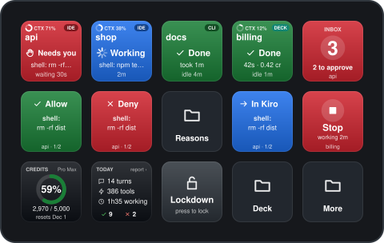

## Contents

1. [Install](#1-install)
2. [Your device](#2-your-device)
3. [Sessions and the Inbox](#3-sessions-and-the-inbox)
4. [Approving and denying](#4-approving-and-denying)
5. [Safety: gates and lockdown](#5-safety-gates-and-lockdown)
6. [Session settings and deck sessions](#6-session-settings-and-deck-sessions)
7. [Credits and today](#7-credits-and-today)
8. [What a press tells you](#8-what-a-press-tells-you)
9. [Settings](#9-settings)
10. [Troubleshooting](#10-troubleshooting)

## 1. Install

You need macOS 13 or later, the [Stream Deck app](https://www.elgato.com/downloads) 7.6 or later, and Kiro IDE or kiro-cli (or both).

**From the installer** (no Node.js needed): double-click `ki-deck-<version>.pkg` and click **Install**. It installs for your user only, so it asks for no administrator password. Stream Deck quits for a moment and starts again; the plugin then sets up the Kiro side by itself, without another dialog, and a notification says when it is done. Then Stream Deck asks, once per device, whether to install the Kiro profile: confirm. An update gives Kiro profiles you already have the new layouts by itself (backups in `~/.ki-deck/backups/`). Then do steps 2 and 3 below: a new chat in Kiro and a reload of open Kiro windows. If macOS says it cannot check the package for malicious software (an unsigned test build), open System Settings, Privacy & Security, and click **Open Anyway**.

**From the plugin package** (no Node.js needed): double-click `net.streiner.ki-deck.streamDeckPlugin`. Stream Deck installs the plugin, then a dialog on the Mac lists what the plugin sets up for Kiro: click **Set up**. A notification says when it is done; then open a new chat in Kiro, reload Kiro windows that were already open, and put the keys on your devices (step 4 below). If you click "Not now", the Inbox key shows **Set up** until you press it. A newer package offers **Update** in the same dialog when Stream Deck starts. The setup puts the `ki-deck` command into a folder your Terminal already searches (such as `~/.local/bin` or Homebrew's `/opt/homebrew/bin`). If there is none, the notification shows the command's full path; to type just `ki-deck`, add `export PATH="$HOME/.ki-deck/bin:$PATH"` to `~/.zshrc`.

**From the repository** (needs Node.js 24: the installer runs on it and builds the plugin):

1. From the repository folder, run the installer. It shows its plan and asks once:

   ```sh
   scripts/install.sh
   ```

   It installs the hook client, the `ki-deck` command and Kiro's global hooks, builds the plugin, links it into Stream Deck, restarts Stream Deck to load it, and installs the companion extension into Kiro.

2. Open a new chat in Kiro (hooks load when a session starts) and send one prompt. If you use kiro-cli, turn on its V3 engine once with `kiro-cli settings chat.agentEngine v3`. Then check:

   ```sh
   ki-deck doctor
   ```

3. Reload any Kiro window that was already open (Command Palette, "Developer: Reload Window"), so it loads the companion extension. Without the reload, that window's own approval prompts do not reach the deck.

4. Put the keys on your devices. Pair the phone first if you use Stream Deck Mobile (Stream Deck app, device menu, "Add Mobile Device"), and open the Mobile app. Then:

   ```sh
   ki-deck profiles
   ```

   Stream Deck asks once per device whether to install the Kiro profile; after you confirm, the device switches to it within a few seconds.

**After an update** with new layouts, run `ki-deck profiles --replace`. Stream Deck never changes a profile it already installed, so this command backs up your Kiro profiles to `~/.ki-deck/backups/`, updates them with the new layouts and restarts Stream Deck. Keys you changed by hand in those profiles are replaced too (the backup keeps them). If Stream Deck ever says it "detected an error restoring the last session" and offers a backup, choose **Cancel**.

**To remove it**, open **Uninstall ki-deck**: the installer put it into the Applications folder in your home folder (Finder: Go, Home, Applications; or search for it in Spotlight). Or run `ki-deck uninstall` in Terminal; both do the same. They remove the hooks, the scripts, the command, the companion extension and the uninstaller app, and the plugin if the installer put it there (Stream Deck quits for a moment and starts again). They keep your `config.json`, the activity log and backups (`ki-deck uninstall --purge` deletes them too). A plugin you installed by double-clicking the `.streamDeckPlugin` stays in Stream Deck until you remove it there (Preferences, Plugins). Kiro keys on your profiles stay until you delete them, and Kiro sessions that are already running keep their hooks until they end.

## 2. Your device

Every layout has the same three zones, and the same folders:

- **Watch:** Session keys and the Inbox. Sessions fill in the order of what needs you.
- **Answer:** Allow and Deny are always on the first page, and Stop for deck sessions.
- **Account and safety:** Credits and Lockdown.
- **Folders:** *Reasons* (deny with a reason, next to the full request), *Deck* (everything for deck sessions), *Safety* (the gate switches), and *More* on small devices.

### Stream Deck and Stream Deck Mobile (5 x 3)

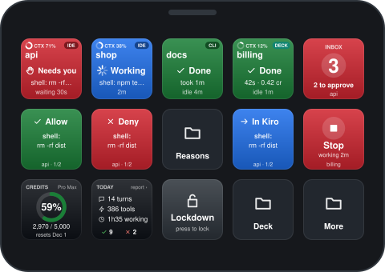

| Reasons | Deck | More |
|---|---|---|
| 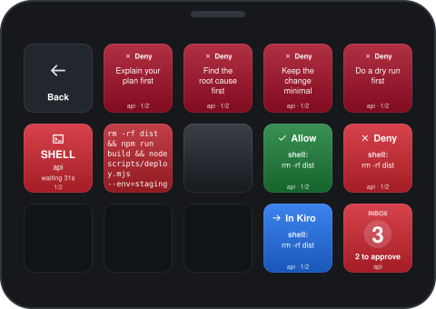 | 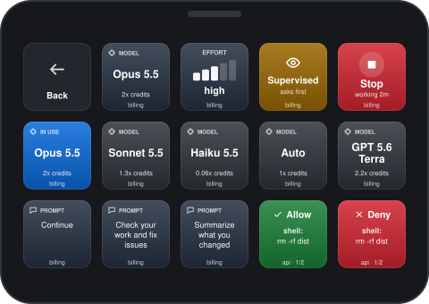 | 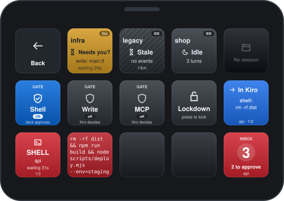 |
| Four reasons, the waiting request in full, Allow and Deny | Model, effort, autonomy, Stop, five model keys, three prompts, and Allow and Deny again | Sessions 5 to 8, the gates and Lockdown, and a 4-key request banner |

### Stream Deck Mini and Stream Deck Mobile on the free tier (3 x 2)

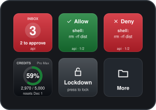

More leads to every folder, so nothing is more than two presses away:

| More | Sessions | Deck | Reasons | Safety |
|---|---|---|---|---|
| 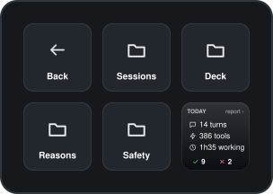 | 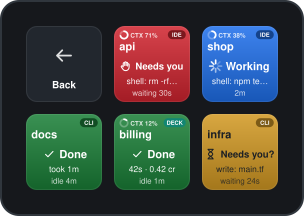 | 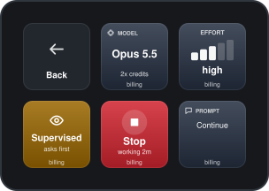 | 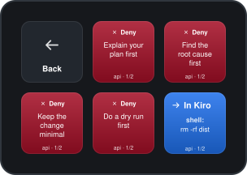 | 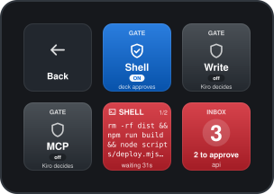 |

### Stream Deck XL (8 x 4)

Row 2 reads and answers the waiting call: the Inbox, a 4-key banner with the whole request, Allow, Deny and Decide in Kiro. Row 3 denies with a reason or stops a deck turn.

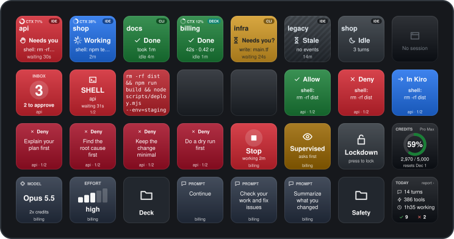

### Stream Deck + (4 x 2 and four dials)

The dials pick a session, choose the model, set the effort, and show credits.

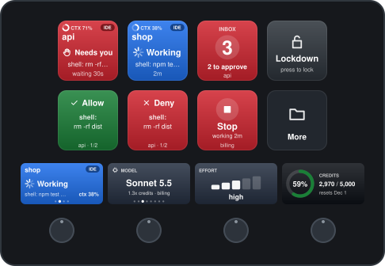

### Stream Deck + XL (9 x 4 and six dials)

Everything on one page. Two session dials watch two sessions side by side.

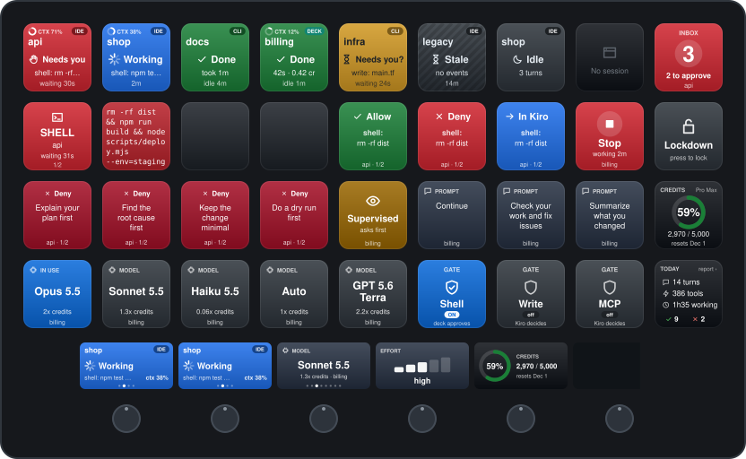

### Stream Deck Neo (4 x 2 and the infobar)

The infobar shows what waits on you and the credits used.

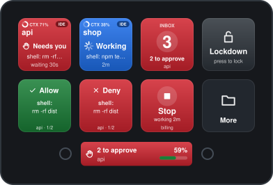

### Stream Deck Pedal

Allow, Inbox, Deny: approve hands-free.

## 3. Sessions and the Inbox

A Session key shows one Kiro session: its workspace, where it runs (IDE, CLI, or DECK for a session the deck runs itself), its state as an icon and a word, what it does, and for how long. Color is never the only signal.

| | | | | |
|---|---|---|---|---|
| 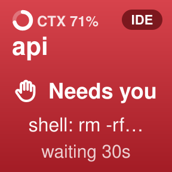 | 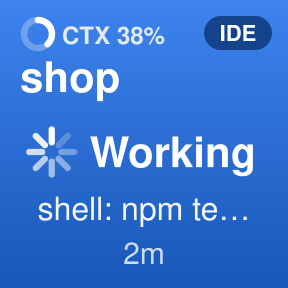 | 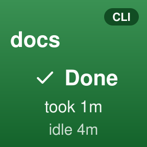 | 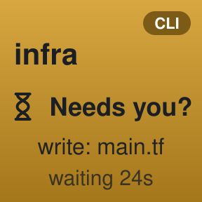 | 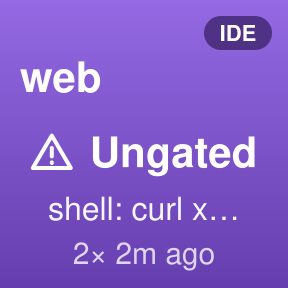 |
| **Needs you:** a call waits for Allow or Deny | **Working:** the current tool, the turn's time, and the context window in use | **Done:** finished, and you have not looked yet | **Needs you?:** a command or write has run for a while; Kiro may be asking | **Ungated:** a call ran without its gate asking the deck |
| 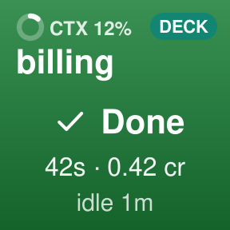 | 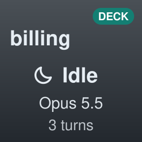 | 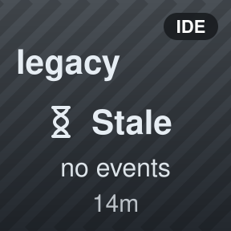 | 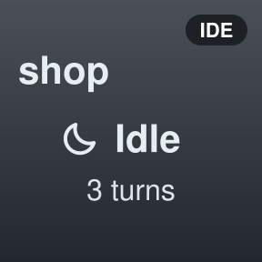 | 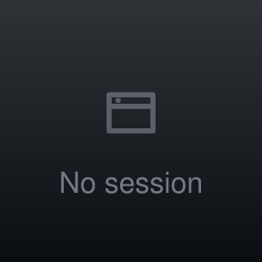 |
| A deck session's turn: time and credits | An idle deck session shows its model | **Stale:** working, but quiet for 10 minutes | **Idle:** seen, nothing running | No session for this key |

- **Press:** bring the session's window, terminal tab or tmux pane forward. In Kiro the window then shows that chat, or the integrated terminal kiro-cli runs in. The pressed IDE or deck session also becomes the target of Model, Effort and Autonomy (needs companion 0.5.0 for IDE controls). A deck session opens its transcript and is also the target of Stop and Prompt.
- **Hold (half a second):** mark a finished turn as seen. Hold again to remove the key's session until it is active again (a deck session closes). A working session stays.
- **CTX** in the top-left corner: how full the chat's context window is. The ring fills up as the conversation grows; when it is nearly full, Kiro will soon summarize (compact) the chat. Shown for Kiro IDE chats and deck sessions; kiro-cli does not report it.
- While a session works, its spinner turns eight steps a second.

Keys are ordered: sessions that need you first, then working ones, then the rest, newest turn first.

The **Inbox** counts sessions that wait on you, approvals first. Press it to jump to the first one; hold it to mark every finished turn as seen.

| | | | |
|---|---|---|---|
| 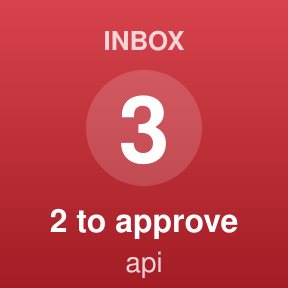 | 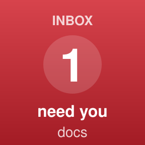 |  | 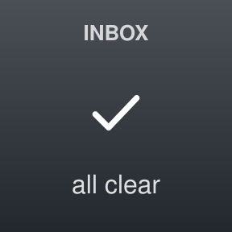 |
| Approvals waiting | Finished turns waiting | Only an ungated alert | All clear |

On Stream Deck +, the **session dial** shows one session on the touch strip: rotate to pick another, push or tap to focus it, touch and hold to clear it.

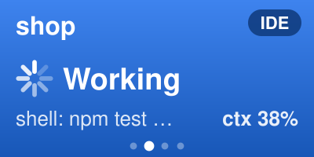

## 4. Approving and denying

Approvals reach the deck three ways, and all three use the same keys:

- **Kiro's own prompt in the IDE**, through the companion extension: nothing to set up beyond the install.
- **Gated calls**: turn on a gate (section 5) and shell, write or MCP calls in every session wait for the deck.
- **Deck sessions** in Supervised mode (section 6).

Allow, Deny and Decide in Kiro always act on the oldest waiting call and show it: category, the command or file, the workspace, and "1/2" when more wait. A press acts at once.

| | | | | |
|---|---|---|---|---|
| 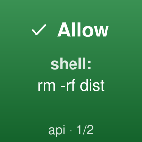 | 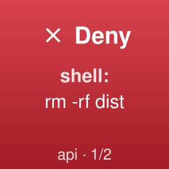 | 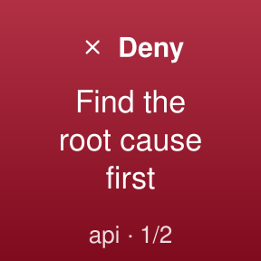 | 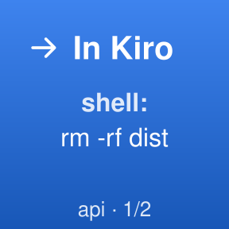 | 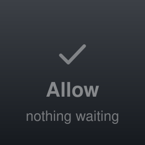 |
| **Allow** | **Deny:** the agent is told not to retry | **Deny with a reason** the agent reads ("Find the root cause first") | **Decide in Kiro:** hand it to Kiro's prompt and bring the window forward | Nothing waiting |

The **request banner** shows the whole request across a row of keys, read left to right:

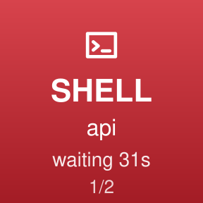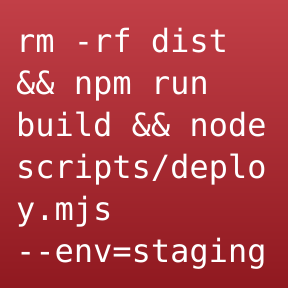

The four reasons that come with it work for any language or tool: *Explain your plan first*, *Find the root cause first*, *Keep the change minimal*, *Do a dry run first* (a `terraform plan`, an Ansible `--check`, a diff before applying). Change them in `config.json` (`denyReasons`, section 9), for example to your project's own rules.

## 5. Safety: gates and lockdown

| | | | |
|---|---|---|---|
| 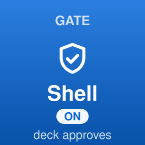 | 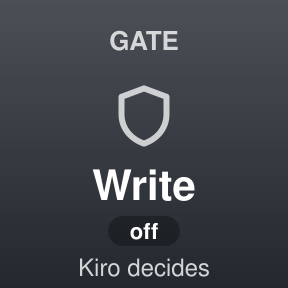 | 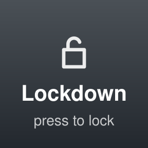 | 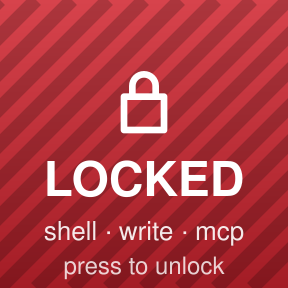 |
| **Gate on:** calls of this kind wait for the deck | **Gate off:** Kiro decides as usual | **Lockdown off** | **Lockdown on:** shell, writes and MCP are blocked in every session |

- **Gates** (Shell, Write, MCP): each press turns one on or off. With a gate on, add Kiro allow rules for that category so you are not asked twice: `ki-deck permissions <workspace>` prints them. Same as `ki-deck gate shell on`.
- **Lockdown** is the panic button. It denies everything waiting, blocks shell, writes and MCP everywhere, stops every running deck turn, and stays on even if Stream Deck quits, until you press it again (or `ki-deck lockdown off`).

## 6. Session settings and deck sessions

Press an IDE or DECK Session key to make that chat the target of **Model**, **Effort**, and **Autonomy**. For an IDE chat, the values come from Kiro's local session metadata. They appear dimmed and do nothing while the companion is offline or before Kiro confirms that the chat accepts setting changes; if metadata is unavailable, they stay blank. With companion 0.5.0 connected, the first selection confirms the choices with Kiro, then the same keys and dials change that exact live IDE session.

A deck session is a Kiro session the plugin runs itself, so the deck additionally controls stop, steering, prompts and every approval. Kiro CLI sessions remain read-only and have no setting values.

Start one from a terminal in your project:

```sh
ki-deck deck start "Add a health check endpoint with a test"
ki-deck deck start --model claude-sonnet-5.5 --effort high --autopilot "Fix the flaky test"
```

Its Session key appears with a DECK badge. Press it to read the transcript (the replies live there) and select it for every control below. For an IDE chat, press its ordinary Session key first; Model, Effort and Autonomy then target it, while Stop and Prompt still target only deck sessions.

| | | | | |
|---|---|---|---|---|
| 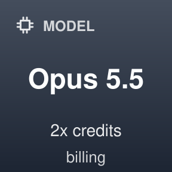 | 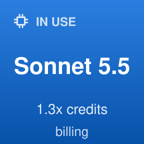 | 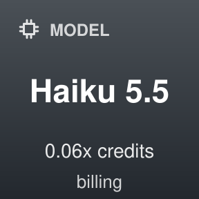 | 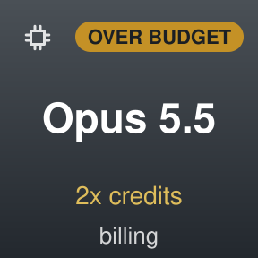 | 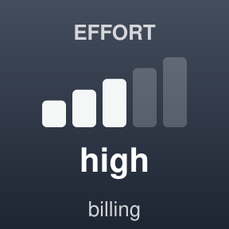 |
| **Model:** press for the next model | A model key in use | A model key: press to switch to it | Credits are low: pricier models are marked | **Effort:** press for the next level |
| 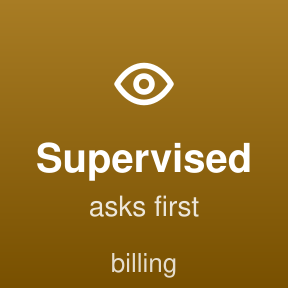 | 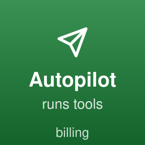 | 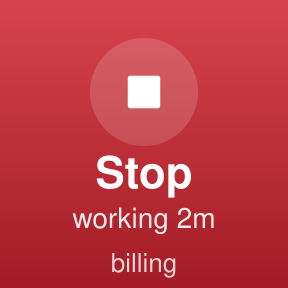 | 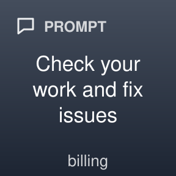 | 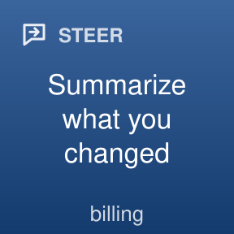 |
| **Supervised:** writes and commands wait for Allow (the default) | **Autopilot:** runs tools on its own | **Stop** the running turn | **Prompt:** send a canned prompt | The same key **steers** a running turn |

- Model and effort choices and credit rates come from Kiro's advertised options. Pick which models the keys offer, and in which order, with `deck.models` in `config.json`.
- A dim value is visible but read-only; a blank tile means Kiro's local metadata was unavailable. Press the Session key again after reconnecting or reloading the companion to retry.
- At the end of a deck session turn that changed files, Supervised mode asks to keep the changes: Allow keeps them, Deny undoes them.
- On Stream Deck + the **model dial** chooses a model as you turn it ("push to apply"), and the **effort dial** changes the level as you turn it.

 

From the terminal, deck-owned sessions have the same controls: `ki-deck deck say "Also update the README"` (a new turn, or steering while it works), `deck model ID`, `deck effort LEVEL`, `deck autopilot on|off`, `deck stop`, `deck open`, `deck close`, `deck list`, `deck models`. The CLI does not target IDE chats.

## 7. Credits and today

| | | |
|---|---|---|
|  |  |  |
| **Credits** used this billing cycle | Amber from 70 %, red from 90 % | **Today:** turns, tool calls, time worked, allowed and denied. Press for the report |

Credits refresh every 15 seconds while an agent works and every 10 minutes otherwise; press the key to refresh now. Reading them costs no credits.

**The activity report:** press the Today key (or hold the Credits key, or touch and hold the usage dial) and your browser on the Mac opens a page about the last 30 days: agent time per day, every workspace with its sessions, turns, time and tool calls, the kinds of tool calls, when you prompt, and how approvals went. It is built on the Mac from the deck's own log and sent nowhere; it shows no commands or file names. From a terminal: `ki-deck report` (`--days 7` for a week).

 

## 8. What a press tells you

After every press the key shows what just happened for about a second, then its live view returns. If nothing could be done, it says why.

| | | | | | |
|---|---|---|---|---|---|
|  |  |  |  |  |  |
|  |  |  |  |  |  |

## 9. Settings

Settings live in `~/.ki-deck/config.json` (open it with `ki-deck config`); the plugin picks up changes within two seconds. The ones you are most likely to change:

| Setting | Default | What it does |
|---|---|---|
| `denyReasons` | four general ones (section 4) | The texts of the deny-with-reason keys |
| `cannedPrompts` | "Continue", "Check your work and fix issues", "Summarize what you changed" | The texts of the Prompt keys |
| `deck.autopilot` | `false` | Deck sessions start Supervised (`false`) or in Autopilot (`true`) |
| `deck.models` | `[]` | Model IDs for the model keys, in order (`ki-deck deck models` lists them); empty: Kiro's order |
| `budget.warnPercent` | `85` | From this share of your credits, model keys mark models above 1x (`0` turns it off) |
| `notifications.macos` | `true` | Notifications on the Mac; `false` turns them off (the deck and pushes to the phone keep working) |
| `notifications.quietHours` | `"22:00-07:00"` | No macOS notifications in this window, except approvals |
| `presentationMode` | `false` | Hide workspace names and commands on every key, for screen sharing |
| `idleExpiryHours` | `8` | Idle sessions leave the deck after this long |
| `notifications.push` | `null` | Push notifications to your phone (below) |

The full list is in the README, section 7.3.

**Push notifications to your phone** (optional, off by default). Stream Deck Mobile only updates while its app is open, so for when you are away from the Mac, the plugin can send a push through [ntfy](https://ntfy.sh) or [Pushover](https://pushover.net):

1. Install the ntfy app on the phone (App Store or Google Play); nothing is needed on the Mac. Make a topic nobody can guess, because anyone who knows it can read it: `echo "kiro-$(openssl rand -hex 12)"`. In the app, tap **+** and subscribe to it on the default server. (Or use your own ntfy server with an access token, or Pushover.)
2. Open `config.json` with `ki-deck config` and, under `notifications`, replace `"push": null` with:

   ```json
   "push": { "provider": "ntfy", "url": "https://ntfy.sh/kiro-7f3a9c2e51" }
   ```

   Pushover: `{ "provider": "pushover", "token": "<application token>", "user": "<user key>" }`.

   A waiting approval reaches the phone only after 5 minutes, and only if nobody answered it meanwhile, so the ones you handle at the Mac never buzz the phone. Change that with `"approvalDelaySeconds"` (`0` sends at once). Add `"events": ["approval"]` for approvals only, or `"awayMinutes": 5` to push only while the Mac has had no keyboard or mouse input for 5 minutes.
3. Run `ki-deck push test`. The phone should show "Test from ki-deck".

A push says which workspace needs you and why ("Wants to run shell", "Finished after 4m"), never the command, a file or code. Approvals come through during quiet hours with high priority; the rest waits. You still answer on the deck.

## 10. Troubleshooting

| Symptom | What to do |
|---|---|
| A key shows the old design, or a key is missing | Run `ki-deck profiles --replace` (section 1), or drag the key in from the "ki-deck" category |
| No sessions appear | `ki-deck doctor`; open a *new* Kiro chat (hooks load when a session starts) |
| Kiro's own approval prompt does not show on the deck, a press does not open the chat, or no CTX shows | That window still runs an older companion extension: reload it (Command Palette, "Developer: Reload Window"). `ki-deck doctor` lists such windows and counts the ones linked to the bridge, and from companion 0.3.0 on each window offers the reload itself after an update. A chat idle since the window loaded shows CTX after its next turn or a press on its key |
| A kiro-cli session does not appear | `kiro-cli settings chat.agentEngine v3`, then start a new chat |
| Model, Effort or Autonomy is blank or dim after selecting an IDE chat | Blank means Kiro's local session metadata was unavailable. Dim means read-only: install/reload companion 0.5.0, then press that chat's Session key again. `ki-deck doctor` shows the companion version. CLI sessions have no setting controls |
| Credits say "unavailable" | kiro-cli must be installed and logged in (`kiro-cli login`); press the key to retry |
| The phone shows nothing new | Open the Stream Deck Mobile app before running `ki-deck profiles` |
| No push arrives | `ki-deck push` shows the setting (or why it is invalid); `ki-deck push test` sends one now. An approval is pushed only after it has waited `approvalDelaySeconds` (default 5 minutes) unanswered. With `awayMinutes`, nothing is pushed while you are at the Mac |
| The Inbox key says "Set up" | The plugin came as a package and the Kiro side is not installed yet: press it, and click "Set up" in the dialog on the Mac |
| Terminal says `ki-deck: command not found` | No folder on your `PATH` could take the command. Run it as `~/.ki-deck/bin/ki-deck`, or add `export PATH="$HOME/.ki-deck/bin:$PATH"` to `~/.zshrc` and open a new Terminal window |
| macOS will not open the installer package | A test build is not signed yet: open System Settings, Privacy & Security, and click **Open Anyway** next to the package's name |
| The installer package says the installation failed | On a Mac whose plugin is linked from the repository, it refuses on purpose: update with `scripts/install.sh` there. Otherwise `/var/log/install.log` has the reason (search for "ki-deck") |
